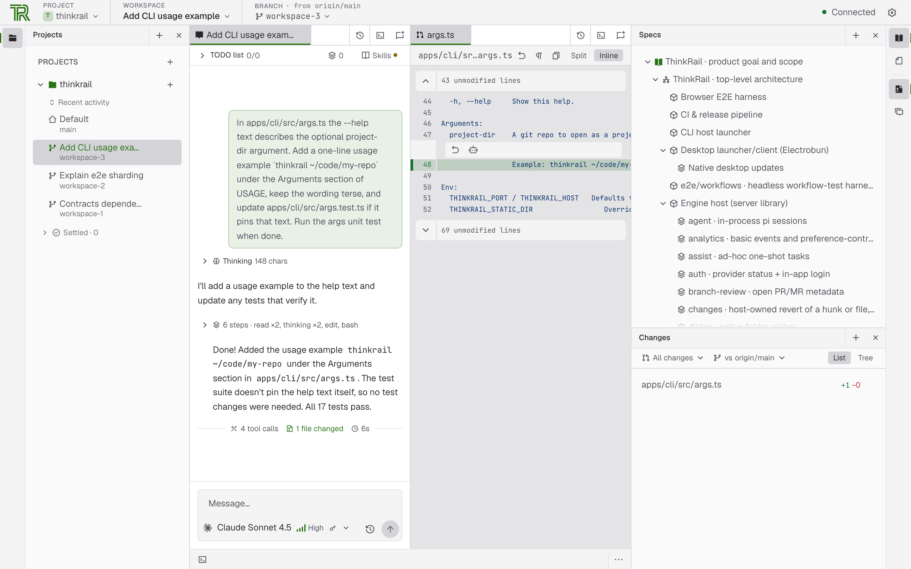
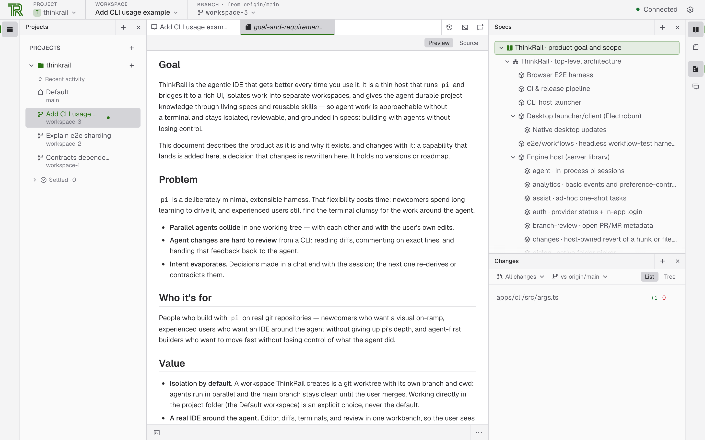

# ThinkRail

[](https://confluence.jetbrains.com/display/ALL/JetBrains+on+GitHub)
[](https://star-history.com/#JetBrains/thinkrail&Date)
[](https://thinkrail.ai/discord)

ThinkRail is an agentic IDE that gets better every time you use it. With Spec-Driven Development support, it learns your project as you work, becoming more capable and helpful over time.

We built a rich interface around the `pi` coding agent, isolated work into separate workspaces, and gave the agent durable project knowledge through the spec graph and reusable skills. We are now adding full extension support, so ThinkRail can create the tools it needs based on how you work.

**Website:** [thinkrail.ai](https://thinkrail.ai/) · **Blog:** [thinkrail.ai/blog](https://thinkrail.ai/blog/) ·
**Discord:** [thinkrail.ai/discord](https://thinkrail.ai/discord)

⭐ If you find ThinkRail useful, give it a star. It helps others discover it.

<p align="center">
 <a href="https://www.star-history.com/jetbrains/thinkrail">
  <picture><source media="(prefers-color-scheme: dark)" srcset="https://api.star-history.com/badge?repo=JetBrains/thinkrail&type=rank&theme=dark" /><source media="(prefers-color-scheme: light)" srcset="https://api.star-history.com/badge?repo=JetBrains/thinkrail&type=rank" /></picture> <picture><source media="(prefers-color-scheme: dark)" srcset="https://api.star-history.com/badge?repo=JetBrains/thinkrail&type=trending&theme=dark" /><source media="(prefers-color-scheme: light)" srcset="https://api.star-history.com/badge?repo=JetBrains/thinkrail&type=trending" /></picture>
 </a>
</p>

<picture>
  <source media="(prefers-color-scheme: dark)" srcset=".github/readme-assets/workbench-dark.png">
  
</picture>
*From the left: An isolated workspace, a work session with an AI agent in that workspace, the code change made by the agent, and the the spec tree.*

## What you get

- **Isolated workspaces.** Open any git repo as a project and create `git worktree` workspaces from it, each with its own branch and working directory. Agents can then work in parallel without touching your original codebase; when they finish, merge the results you want to keep and delete the rest. You can also attach existing git worktrees or explicitly work in the project folder.

  * Finished and dormant workspaces are settled when their pull request merges or closes, or after a quiet week, and return the moment you work in them again.

  * The topbar shows where the active branch stands against `origin`, and the state of its pull request. From there you can publish, push, or open a new PR described from the plan, the commits, your PR template, or an agent-written draft.

  * Once a GitHub PR is open, ThinkRail shows its CI checks and review decision, and lets you mark it ready, merge it, reopen it, or delete the remote branch.

- **An IDE around the agent.** ThinkRail comes with Monaco editor tabs, a files tree integrated with git to show code changes as they happen, terminals, and document support.

- **Powerful chat features.** You can open several concurrent work sessions per workspace, each with its own model. Send a prompt, or queue it as a follow-up, delegate to subagents, and work together on a shared plan: the agent updates it, and you review and edit.

- **Find chats.** `⌘K` (or a double tap of Shift) opens a "Switch sessions" popup that lets you find chats across your workspaces and projects.

- **Always up-to-date specifications.** A connected graph of `SPEC.md` files lives beside the code; the agent reads, searches, and maintains it through dedicated `spec_*` tools, so project intent persists across sessions. The read-only Specs tool renders the graph as a tree in its own view.

- **Skills.** ThinkRail imports skills from `pi`, Claude, Codex, and other coding agents, as well as any already in your project.

- **Agent tools beyond the shell.** Thanks to the ThinkRail GUI, your AI agent can ask you structured multiple-choice questions in the chat instead of guessing, draw Mermaid diagrams, and show comparisons and file previews. When the agent proposes a UI change, it shows a before/after mockup you can comment on like a diff.

  - Settings → Extensions lists the ThinkRail extensions the agent may use. It can also install any `pi` package by source (npm, git or a local folder), for you or for a repository, showing what each one adds and letting you switch individual packages, their extensions and skills, and `pi`'s built-ins on or off.
  - The tools behind the questions, diagrams, and previews are also published as plain `pi` packages: `pi install npm:@thinkrail/pi-ask-user-question` for the questions ([ `@thinkrail/pi-ask-user-question`](https://www.npmjs.com/package/@thinkrail/pi-ask-user-question)) and `pi install npm:@thinkrail/pi-visualize` for the diagrams and previews ([ `@thinkrail/pi-visualize`](https://www.npmjs.com/package/@thinkrail/pi-visualize)), so a vanilla `pi` in the terminal gets the same tools.

- **MCP servers.** Connect the MCP servers in your `pi` `mcp.json`, or configure them in Settings. ThinkRail asks in the chat before calls that the server does not mark read-only, or always allows the tools you trust in a project. Servers a repository defines stay off until you approve them. ThinkRail signs you in to OAuth servers from Settings and shows each chat's servers next to its background commands and subagents.

- **Your providers, your credentials.** Sign in with [ JetBrains AI](https://www.jetbrains.com/ai/) or connect any provider through `pi`'s own auth. ThinkRail has no accounts of its own.

- **Your `pi` setup.** ThinkRail reads your existing `pi` configuration (`~/.pi/agent`). To use another one (for example, a personal `~/.pi/agent-personal`), or to pass extra environment variables to the agent, terminals and MCP servers, set them in Settings → Environment. The configuration becomes active on the next start.

- **Your own model servers.** Go to Settings → Providers → Custom servers and connect a company LLM gateway or a model running on your own machine. Any OpenAI-compatible server fits: LiteLLM, sglang, vLLM, Ollama, LM Studio, or llama.cpp.

  - The **Find models** button lists the models available on the server, together with their capabilities. The server is saved to `pi`'s `models.json`. The models models appear in the chat model picker, and in the `pi` CLI alike.

- **Desktop app or browser.** A native desktop app, or the `thinkrail` CLI that opens the same app in your browser. Both embed the same engine host. App state lives under `~/.thinkrail`.

- **Your language.** ThinkRail uses your system language or a language you pick in Settings → Language: English, Japanese, Russian, Simplified Chinese, or Spanish. You can add a language ThinkRail doesn't ship yet by putting a translated locale file, for example `de.json`, in `~/.thinkrail/locales`. (Tell your AI agent to do it for you!)

- **Your themes.** In Settings → Appearance, you can choose from dark, light, minimal, and high-contrast themes. You can also make your own theme by copying a bundled `*.theme.json`, changing its id and colors, and saving it to `~/.thinkrail/themes`. (Again, tell your AI agent to do it for you!)

- **Your fonts.** In Settings → Appearance, you can pick the interface and code fonts. You can choose from the bundled Geist and JetBrains Mono, any font installed on your computer, and font files kept in `~/.thinkrail/fonts`, with fallback fonts for icon glyphs, a code size, ligatures, and a text-weight slider.

<picture>
  <source media="(prefers-color-scheme: dark)" srcset=".github/readme-assets/specs-dark.png">
  
</picture>
*The project's spec graph as a tree (on the right), with the spec itself rendered alongside in the center.*

## Install

ThinkRail ships in two forms: a native desktop installer and the self-contained `thinkrail` CLI. Both are published with `SHA256SUMS` on the [ releases page](https://github.com/JetBrains/thinkrail/releases).

### 	Desktop

Download the `thinkrail-desktop-*` asset for your platform:

- **macOS 14+ (Apple Silicon or Intel)**: open the DMG for your architecture: `thinkrail-desktop-darwin-arm64.dmg` or `thinkrail-desktop-darwin-x64.dmg`.
- **Windows x64**: extract the complete setup ZIP, then run the executable.
- **Linux x64 / ARM64**: extract the setup tarball and run `installer`. Desktop builds need glibc 2.38+ with GTK 3, WebKitGTK 4.1, Ayatana AppIndicator 3, librsvg 2, and Ubuntu 24.04 or newer:
  
  ```bash
  sudo apt install libgtk-3-0 libwebkit2gtk-4.1-0 libayatana-appindicator3-1 librsvg2-2
  ```

There are two update channels: stable and nightly. If the ThinkRail desktop app, you can check them in **Settings → Updates**: **Download** → **Preparing update** → **Install & Restart**.
### Command line

The installer downloads the right binary, verifies its SHA-256 checksum, and puts `thinkrail` on your PATH.

**macOS / Linux** (also Windows under Git Bash):

```bash
curl -fsSL https://raw.githubusercontent.com/JetBrains/thinkrail/main/install.sh | bash
```

**Windows**: the same command works from cmd and PowerShell:

```powershell
powershell -c "irm https://raw.githubusercontent.com/JetBrains/thinkrail/main/install.ps1 | iex"
```

Then run `thinkrail`, optionally with a git repo to open as a project:

```bash
thinkrail ~/code/my-repo
```

* `thinkrail` needs `git` on your PATH and a model provider. You can sign in with JetBrains AI from the app or use your own provider credentials. The first launch walks you through connecting a provider and picking a project; **Start a new project** creates an empty git repository (under `~/thinkrail` by default), so you don't need one ready.
* **Add project → Clone repository…** clones a Git URL into a new folder on the computer running ThinkRail and opens it as a project. Choose the parent folder and folder name, optionally limit the history depth, or cancel an in-progress clone.
* GitHub and other Git hosts work with the Git credentials and SSH keys already on your machine.
* `thinkrail --help` lists the flags, and `thinkrail --version` prints the build.

<details>
<summary><strong>Nightly builds, pinned versions, updates, and uninstall</strong></summary>
The installer takes `--channel stable|nightly` and `--version`; a pinned version must belong to the
selected channel:

```bash
thinkrail update --channel stable
thinkrail update --channel nightly
thinkrail update --channel stable --version 0.3.1
thinkrail update --channel nightly --version 0.4.0-nightly.2
```

On Windows the options are environment variables (`THINKRAIL_CHANNEL`, `THINKRAIL_VERSION`, `THINKRAIL_PREFIX`, `THINKRAIL_NO_MODIFY_PATH`):

```powershell
$env:THINKRAIL_CHANNEL='nightly'; irm https://raw.githubusercontent.com/JetBrains/thinkrail/main/install.ps1 | iex   # PowerShell
set "THINKRAIL_CHANNEL=stable" && set "THINKRAIL_VERSION=0.3.1" && powershell -c "irm https://raw.githubusercontent.com/JetBrains/thinkrail/main/install.ps1 | iex"   # cmd
```

If you keep ThinkRail running, it periodically checks for updates and, when it finds one, shows an "Update available" button in the GUI.

`thinkrail uninstall` removes the executable, the PATH entry the installer added, and the install metadata; it then asks whether to delete your `~/.thinkrail` app state (kept by default; `--remove-data` deletes it, and `-y` skips the questions).

If you prefer a manual install, download a binary and the `SHA256SUMS` from the releases page, and verify the checksum. For self-update to work, rename it to `thinkrail` (`thinkrail.exe` on Windows) and place it at `<prefix>/bin/thinkrail[.exe]`; a binary kept under its release filename or elsewhere must be replaced manually or reinstalled with the script.

### Platform notes

| Platform | Desktop | CLI |
| --- | --- | --- |
| macOS Apple Silicon / Intel | DMG | signed binary |
| Windows x64 | signed setup executable and app binaries | signed `.exe` |
| Linux x64 / ARM64 | setup tarball, unsigned | unsigned |

JetBrains signs the Windows CLI, the desktop setup executable, and every executable and DLL the desktop app installs. The macOS CLI is signed but not yet notarized. Signed and notarized desktop DMGs must come from the coordinated JetBrains service pipeline; older published DMGs and locally built packages may still be unsigned and blocked by Gatekeeper. Linux artifacts are unsigned.

## Analytics & privacy

ThinkRail apps collect basic usage events: launches, chat creation, message sends, and provider connections. The data is tied to a random installation ID. Usage analytics never include prompts, code, files, credentials, or account identity. Error reports are always sent as well, tied to the same installation ID, so we can fix crashes: they include the error type and code, and where in ThinkRail's own code it happened. They never include error messages, file paths, names, URLs, or anything from your projects or extensions.

Additional product usage is shared only while **Share additional usage data** is on; the switch is offered during first-run setup (or right after you skip it) and lives in **Settings → Privacy**. From the command line, `thinkrail --no-analytics` (or `THINKRAIL_NO_ANALYTICS=1`) turns additional sharing off for that launch. With additional sharing on, a packaged build may open the ThinkRail blog in your browser once to link your installation to the website visit that brought you here - only where you accepted marketing cookies on the website or no consent is required, and that link expires after 30 days.

Feedback surveys are separate from usage analytics. ThinkRail may invite you to a short survey, and you can also open it from **Settings → Feedback**. Your answers, including anything you type, are sent to the ThinkRail team only when you press **Send**, and tied to the same random installation ID, not to your name or account. Please don't include secrets, code, or personal data. To have your answers deleted, email [info@thinkrail.ai](mailto:info@thinkrail.ai).

The ThinkRail apps and the ThinkRail website ([ thinkrail.ai](https://thinkrail.ai/)) use PostHog Inc. services for analytics. The website also uses PostHog Surveys to collect feedback after a desktop download and, only if you choose to provide it, your email address, which is used to ask for further feedback and to send product updates. PostHog's privacy policy is at [ posthog.com/privacy](https://posthog.com/privacy).

## Under the hood

ThinkRail is a thin host that runs `pi` in-process and bridges it to a web UI. `pi` owns models, skills, compaction, cost, and session state. ThinkRail owns workspace management, the GUI, and the contracts between the engine and the GUI.

* **Engine** (`packages/server` + `packages/shared`): a `Bun.serve` HTTP+WS host with one in-process `pi` session per chat, launched by `apps/cli` or `apps/desktop`.
* **Contracts** (`packages/contracts`): the typed, versioned protocol between the engine and the GUI.
* **GUI** (`apps/web`): React 19 + Zustand + Tailwind v4, shipped independently; it communicates with the engine through the contracts.

`goal-and-requirements.md` and `architecture.md` are the product and design specs. ThinkRail is developed spec-first: a `SPEC.md` sits beside every module, and when a change made by an AI agent moves a boundary or a contract, the spec is updated in the same change.

## Developing ThinkRail

You need **Bun** 1.4.4 (the pinned package manager and runtime), **Node.js** ≥ 22.19 (required by the
in-process `pi` engine), and an AI provider for agent work.

```bash
git clone https://github.com/JetBrains/thinkrail.git
cd thinkrail
bun install
bun run dev                          # host + web client together; Ctrl+C stops both
```

```bash
bun run --filter @thinkrail/cli dev  # browser launcher
bun run build:binary                 # standalone CLI artifact
bun run desktop:dev                  # package and open the Electrobun app
bun run desktop:build                # package without opening it
```

[`CONTRIBUTING.md`](CONTRIBUTING.md) covers the checks, the end-to-end suites, desktop packaging, and the repository layout.

## Contributing

Contributions are welcome. See [`CONTRIBUTING.md`](CONTRIBUTING.md). This project and community are governed by the [Code of Conduct](CODE_OF_CONDUCT.md).

## Community

Join us on [Discord](https://thinkrail.ai/discord) to ask questions, share what you're building, and talk to the team. Bugs and feature requests go to [GitHub issues](https://github.com/JetBrains/thinkrail/issues).

## License

Licensed under the [Apache License 2.0](LICENSE).
