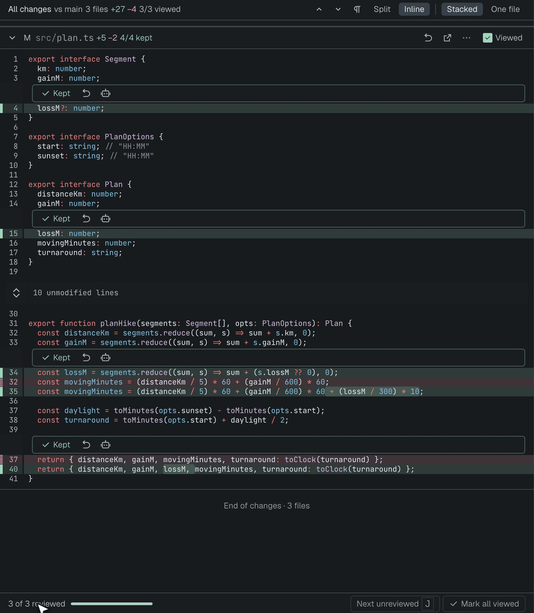
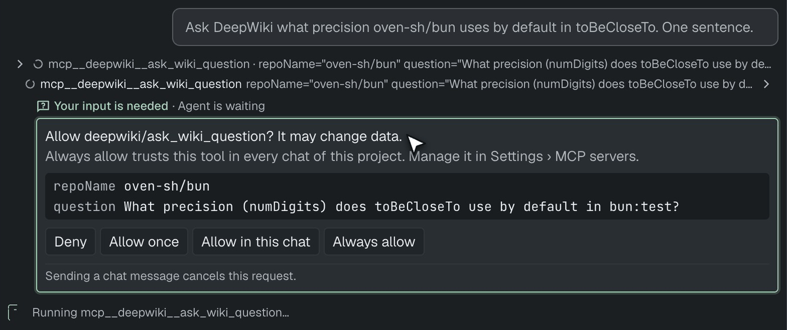
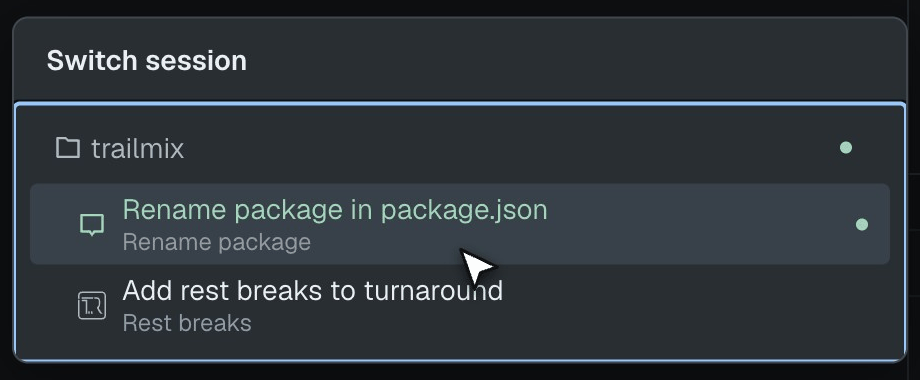
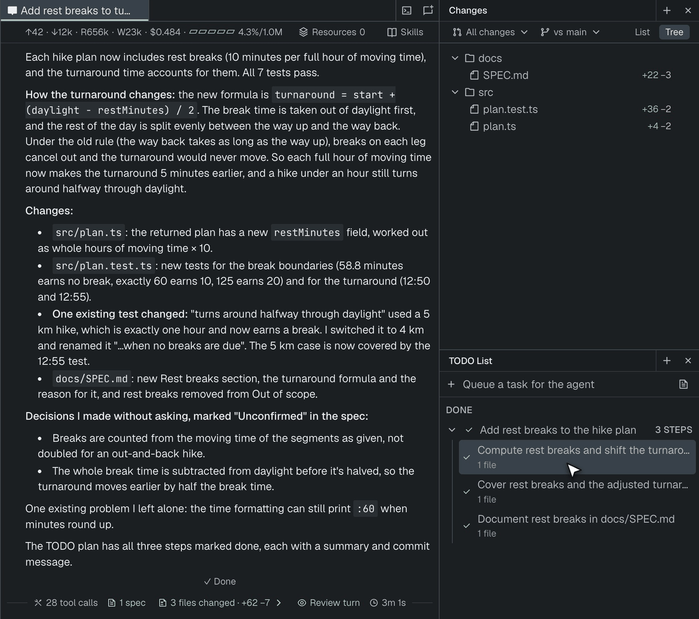
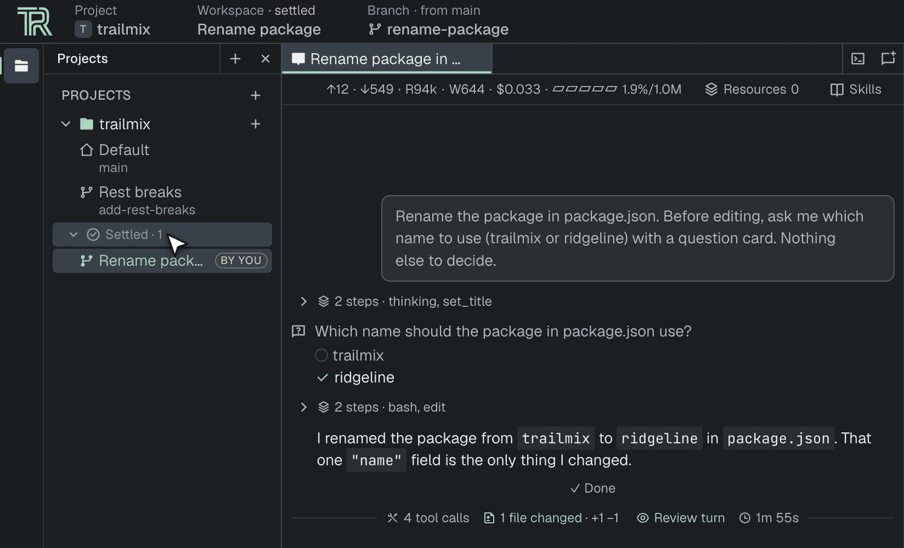
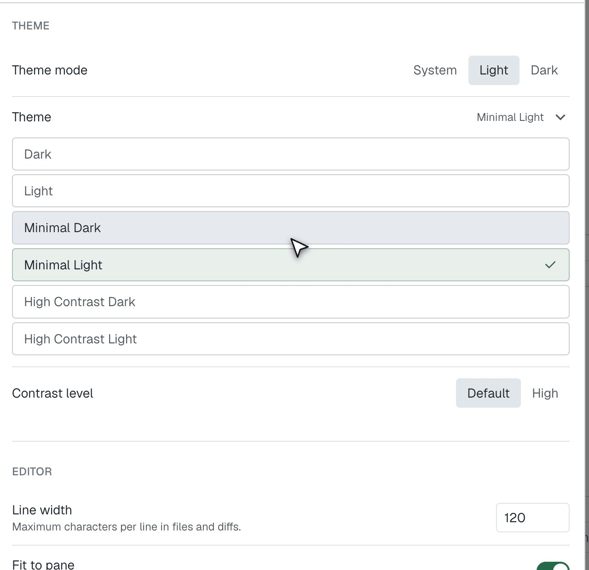

[ThinkRail](https://thinkrail.ai/?utm_source=blog&utm_medium=organic-social&utm_campaign=release-0-2-0) 0.2.0 is out. The new release of ThinkRail introduces a few new features that we’ve been working on for some time, as well as a number of fixes and other changes. Here's what I find the most important among them.

## Every turn gets a receipt

The main thing I wanted fixed was a habit I kept catching myself in. The agent finishes, says it's done, and I scroll the transcript trying to piece together what it actually changed. That isn't a review. It's archaeology.

When a run changes something, the round now ends with a line like `3 files changed · +27 −4` and a **Review turn** button. The numbers don't come from the agent's own tool calls. The host snapshots the worktree when the run starts and again when it settles, so a shell command that rewrote a file, a formatter, or a rename all count. HEAD, the index and your reflog aren't touched.

**Review turn** opens one Changes tab with every file from that run stacked, so you read the whole thing in one scroll. Markdown still shows as rendered text, code as a normal diff. If you'd rather go file by file, **One file** is a view mode of the same tab, so switching keeps your progress.

On the branch diff (**All changes**), each hunk gets **Keep**, **Revert** and **Ask agent about this hunk**. Keeping the last hunk of a file marks it viewed, the progress bar fills up, and **Next unreviewed** (`J`) takes you to the next file you haven't read. Keep is keyed to the hunk's content, so it survives line shifts and lapses when the agent edits that hunk again.

Rough edge: the single-turn view is read-only, so Keep only works on the branch diff. Big diffs start collapsed (over 400 changed lines, lock files, generated files), and past 50 files you get a hint to switch to One file.

## MCP servers, finally

ThinkRail now runs the MCP servers from your `mcp.json` in chats, on pi's built-in engine. **Settings › MCP servers** has presets for Context7, DeepWiki, Linear (read-only), Sentry and Playwright, a form, and a paste-JSON route. Settings stores references only: secrets have to be `${VAR}` or `!command`, and it refuses credentials pasted into URLs. Servers a repository ships in `.pi/mcp.json` don't start until you approve exactly what they'll run.

When a call may change data, the question shows up on the tool card itself, with the arguments listed: **Deny · Allow once · Allow in this chat · Always allow**. Always allow trusts that one tool in every chat of this project. The grant lives on the project record, not in `.pi/mcp.json`, so a repo can't ship itself pre-approved. It resets when the server's command or URL changes.

Extension dialogs in general (permission gates, confirms, `/mcp login`) are now asked inside the chat too, instead of as a modal over the whole app.

## Cmd/Ctrl+K to the chat that needs you

With a few agents running, the annoying part is noticing which one is waiting on you. **Cmd/Ctrl+K** opens a switcher with only the chats that need you or are still running, grouped by project, needs-input first. It includes workspaces you haven't opened in this window. Click and you're in.

Chats that are only waiting on background commands or subagents now show as running instead of looking finished, and an unread result clears when you've actually seen it.

## The plan moved to a rail

The TODO plan now lives in a **TODO List** side rail next to Changes and Review, scoped to the active chat: Up next, Now, Done. The chat popover and header chip are gone. The full Plan page is still one click away and shows each done step's summary and verification inline. The plan summary is written as a PR body (`## Summary / ## Changes / ## Testing`), and the PR skill uses it.

## Finished workspaces park themselves

The workspace list used to only grow. Now each project has a **Settled** shelf. A workspace moves there when its PR merges or closes, or after 7 idle days (Settings › Workspaces: 1, 3, 7, 14 or never). **Settle** and **Keep active** override that either way. Activity means work (chat turns, terminal input, a HEAD move), not just looking at it.

## New look

Projects, Specs, Files, Changes and Review moved to edge tool rails. The layout is denser, with a tighter line height. Settings got a redesign, the loader too, notifications look the same everywhere now, and the model picker sets provider groups apart. There are two new themes, **Minimal Light** and **Minimal Dark**. Toggling a panel also no longer remounts the whole app, which used to cost about 1,900 component mounts per click.

## Smaller improvements

- The design interview is back by default: every feature, behavior change or bug fix starts with the agent questioning you and updating the specs. It also has to show you the alternatives it rejected instead of deciding silently.
- Untrusted projects no longer load their own `.pi` settings, extensions, skills, prompts or `SYSTEM.md`, and the trust notice names what trusting would load.
- **Settings › Extensions** lists ThinkRail's extensions with an on/off switch each.
- Subagents per chat are a setting now (1–16, default 4), globally and per workspace, and changes apply to running chats.
- Rename projects from the project's context menu.
- Chats reopen even when their saved model is unavailable. They fall back to your current default, and the saved model only changes if you send a message.
- Huge files and diffs are virtualized, so opening one no longer freezes the UI. Chat code highlighting runs off the main thread, and streaming re-renders far less.
- Cmd/Ctrl+, opens Settings in the desktop app.
- pi 1.2.0.

Thanks to everyone who sent PRs, and welcome to first-time contributors [@zhuravlikjb](https://github.com/zhuravlikjb), [@HadesArchitect](https://github.com/HadesArchitect) and [@superjackche](https://github.com/superjackche).

## Try it

Grab the desktop app below, or see the rest of what ThinkRail does on [**our main webpage**](https://thinkrail.ai/?utm_source=blog&utm_medium=organic-social&utm_campaign=release-0-2-0). The full list of changes is in the [**v0.2.0 release notes**](https://github.com/JetBrains/thinkrail/releases/tag/v0.2.0).

Find us on social media platforms: [**X/Twitter**](https://x.com/ThinkRailAI), [**YouTube**](https://www.youtube.com/@ThinkRailAI), and [**TikTok**](https://www.tiktok.com/@thinkrail).
You can also browse [**our GitHub repository**](https://github.com/JetBrains/thinkrail),
take [**our survey**](https://forms.gle/es1ksqAax6hnDWCP8), and join [**our Discord server**](https://discord.gg/Wybu9ceWkY)
to say "hi!" and let us know what you think. Your feedback is greatly appreciated.

Happy developing!

------

*ThinkRail is backed by JetBrains, leveraging their expertise in building developer tools that are both powerful and intuitive.*

