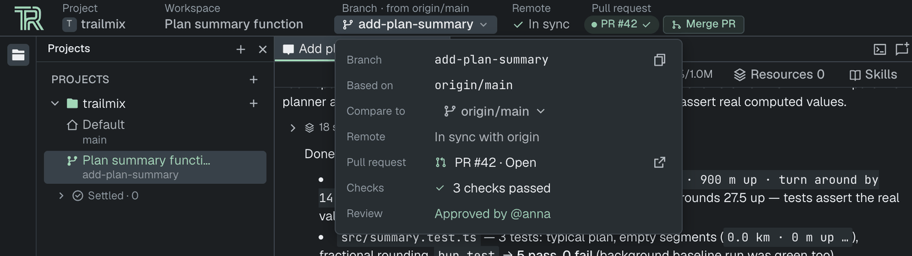
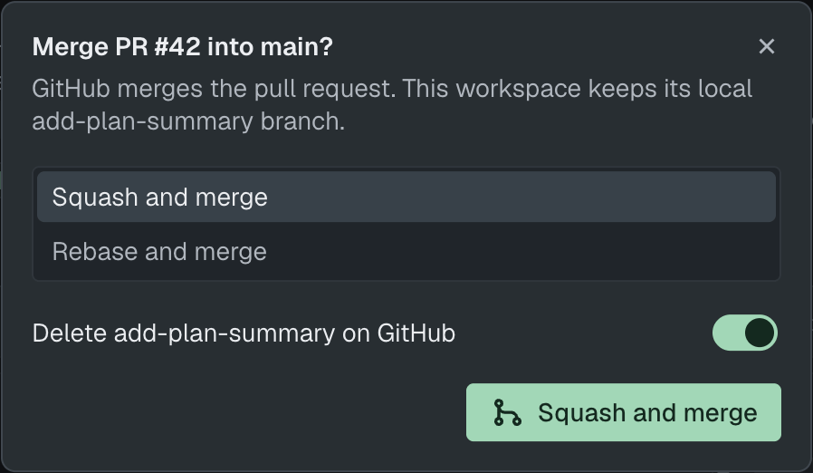
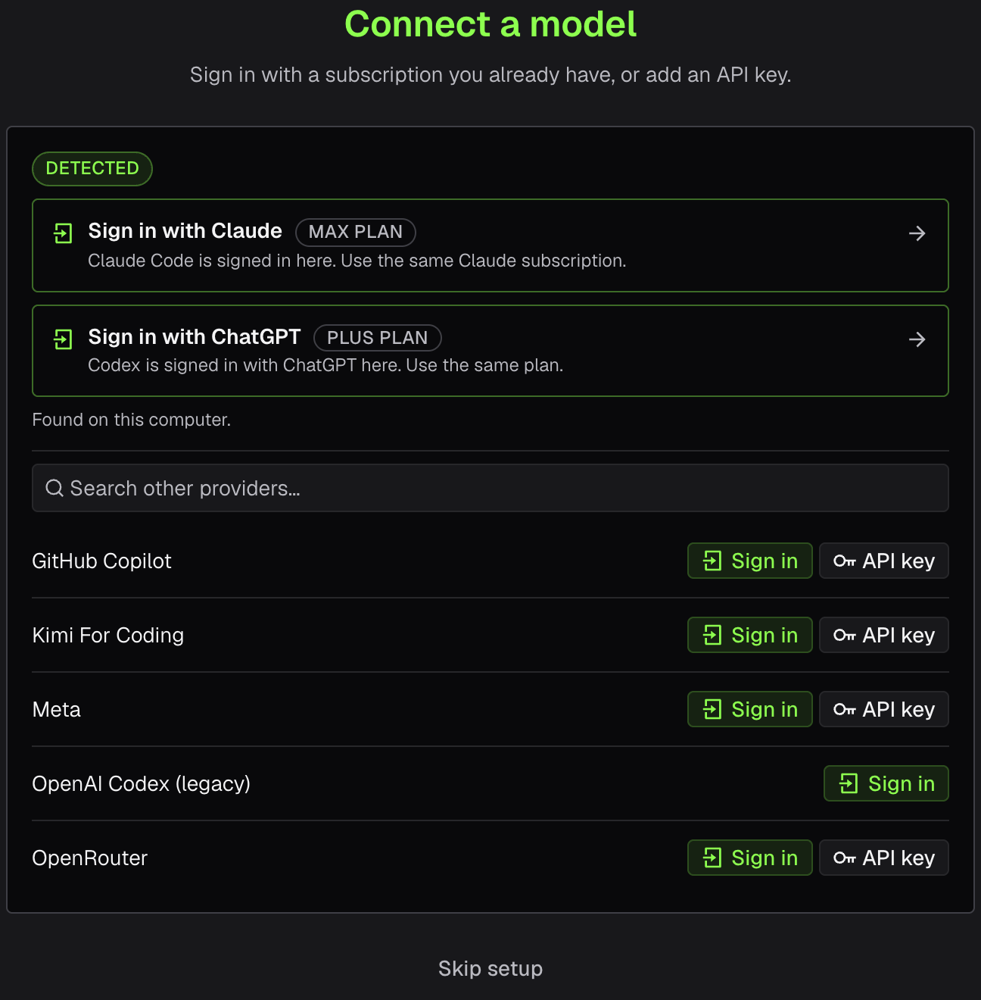
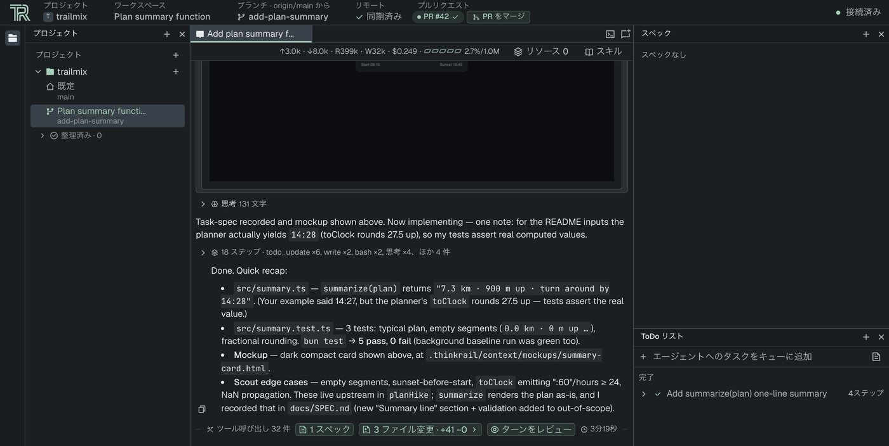
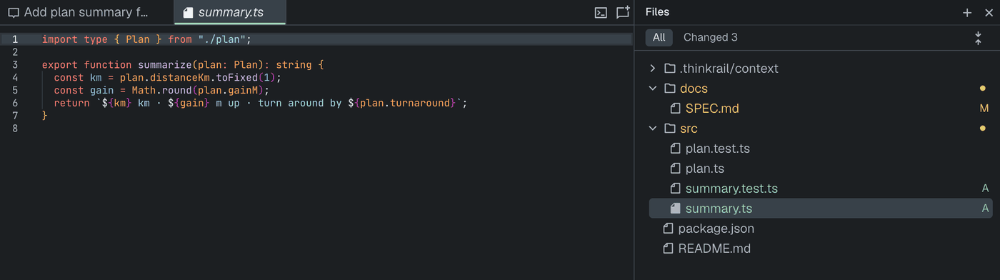
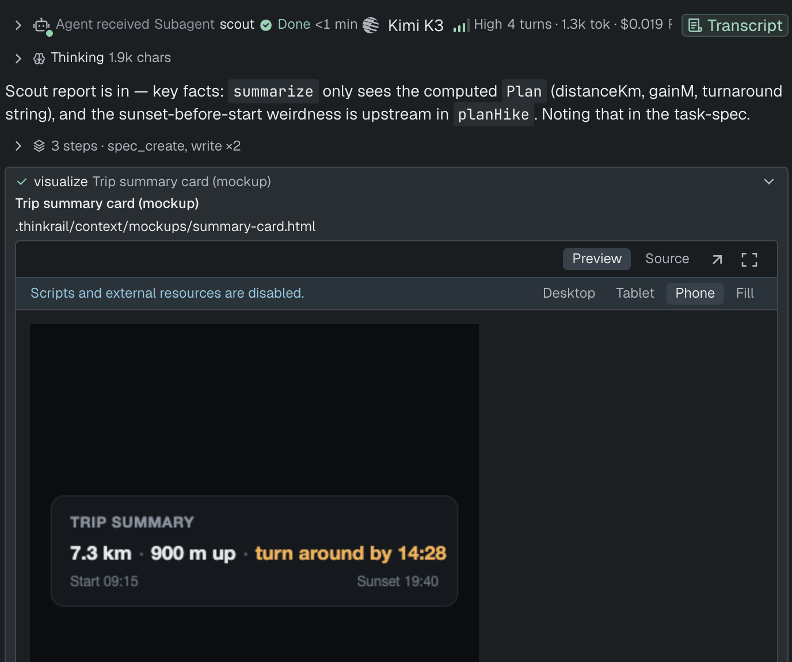
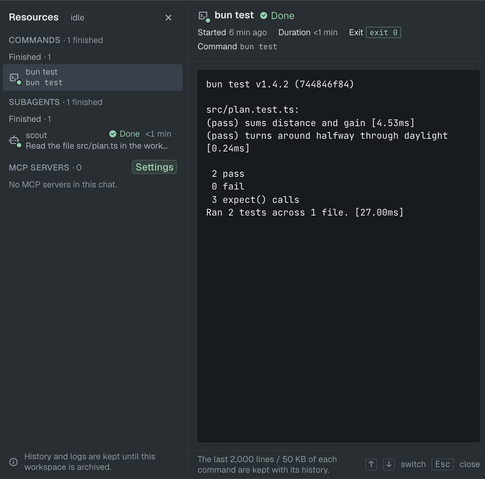

[ThinkRail](https://thinkrail.ai/?utm_source=blog&utm_medium=organic-social&utm_campaign=release-0-3-0) 0.3.0 is out. The new release of ThinkRail introduces a few new features that we've been working on for some time, as well as a number of fixes and other changes. Here's what I find the most important among them.

## Ship the branch from the topbar

The main thing I wanted fixed was the last mile. The agent finishes, I review the diff, and then I leave the app: a terminal to push, the browser to open the PR, another tab to wait for CI, back to GitHub to merge. Four context switches to do the boring part.

Now the topbar always shows **Remote** and **Pull request** for the open workspace, and each one tells you the next step. Remote reads *No remote*, *Not published*, *In sync*, or how far ahead or behind you are, with **Publish**, **Push N** or **Sync…** right next to it. Sync shows you the `git pull --rebase` it would run and never force-pushes.

**Open PR** uses the same dialog as the Plan pane. The description can come from the chat's plan, the commits, your repository's PR template, or nothing, and **Generate with agent** drafts it without dropping a message into the chat. On GitLab you get **Create MR**.

Once the PR is open, the topbar shows the checks and the review decision, and the button moves to whatever comes next: **Fix with agent** when checks fail, **Ready for review** for a draft, **Merge PR** when GitHub says it's mergeable. Merge goes by GitHub's merge state, not by counting approvals. The merge dialog offers only the methods your repo allows and remembers your choice per project. A merged or closed PR gets **Reopen** and **Delete remote branch**. While checks run, it re-reads them every 20 seconds.

It talks to GitHub through your `gh` CLI, so `gh` has to be installed and signed in. Not there yet: merging locally, and review actions on GitLab.

## A first run that ends with a working model

A fresh install used to open on an empty Projects rail, a "No model provider connected" warning and a long list of providers in Settings. Not a great first five minutes.

Now a short wizard takes over the window: a quick intro, the privacy question, then **Connect a model**. If Claude Code, Codex, Copilot, Kimi CLI or Grok Build is already signed in on your machine, it shows up under **Detected** with your plan. ThinkRail only reads those tools' own config files to find them (no Keychain, no network), and it never borrows their credentials: you still sign in through pi's own flow. When a provider is connected, it checks that the provider really lists models and a default, without spending tokens, and drops you on **Start a new project** or **Open project**. **Skip setup** is there if you know what you're doing.

Related fix: the model list now shows only the models your account can actually use. Signing in with ChatGPT used to offer the whole OpenAI API catalog, and the first chat died on `gpt-4` with a 400. New chats now start on pi's default for the provider instead of whatever came first in the list.

## ThinkRail in your language

The interface is no longer English-only. Spanish, Simplified Chinese and Japanese ship built in, and **System** follows your OS language. Switch it in **Settings › Language**.

Missing your language? Download `en.json` from that page, translate it, and save it as `~/.thinkrail/locales/<code>.json`. ThinkRail picks it up as you save, and any string you haven't translated stays in English. If it's good, send it to us and it ships for everyone, which is exactly how Chinese, Spanish and Japanese got in. Agent replies, tool output and skills aren't translated: that's the model's job, not the UI's.

## Files and Changes are one panel now

There used to be two trees for the same worktree: **Files** to navigate and **Changes** to review. Now there's one Files panel with an **All | Changed** switch, like the explorer you already know from VS Code or IntelliJ. Changed files and the folders that hold them are marked right in the tree, and it remembers which folders you had open when you switch views, change workspaces or reload.

## The agent can show you instead of telling you

When the agent proposes a UI change, you used to get a paragraph of prose or some ASCII art and had to picture it yourself. Now `visualize` can put a file right in the chat: any workspace file, or a self-contained HTML mockup it writes for you, with a before/after diff when there's a previous version. It uses the same renderers as the diff review, with **Desktop**, **Tablet** and **Phone** widths. Scripts and external resources are turned off in the preview.

## Background work stays out of your way

Background commands and subagents were noisy. A finished command landed as a box with a scrolling log that never folded, results seemed to pop up at random, and the dock above the composer filled up with old results.

Now a finished result folds into one row with its own round in the chat. The dock lists only work that's still running, plus one line like `✓ 2 finished · 2 new · Open Resources`. **Resources** keeps every chat's history, and it survives restarts now (logs keep their last 2,000 lines / 50 KB). It also shows which model and effort each subagent actually ran on.

The agent side got fixed too. Results used to reach the agent twice: once when it polled for them, and again as an extra turn at the end that said "already handled". In the local session logs we checked, 174 of 195 background completions were duplicates like that. Now each result is delivered once, at the agent's next step.

## The cost number is honest now

The `$` in the chat toolbar only counted the parent session. Every subagent runs in its own session, so a chat that delegated a lot could cost several times what it showed. Now subagent spend is counted, live while it runs. Older chats get back-filled when you open them, so don't be surprised when an old chat's number goes up. It was always that much.

## Smaller things worth knowing

- **Clone a repository.** **Clone repository…** in the Projects rail and on Welcome takes any Git URL and uses your existing Git credentials and SSH keys. It opens the checkout without starting an agent or trusting the project for you.
- **Your own themes.** Copy a bundled theme into `~/.thinkrail/themes/<name>.theme.json`, change the colours, and it appears in **Settings › Appearance** without a restart. Editing the active file re-themes the app live. A broken file is listed with the reason instead of breaking anything.
- **Your pi setup, your env vars.** **Settings › Environment** lets you point ThinkRail at another pi config folder (settings, sign-ins, extensions, skills, history) and pass environment variables to the agent, terminals and MCP servers. It needs a restart, and chat history follows the folder, same as pi's CLI.
- **Skills survive compaction.** After a context compaction the agent used to keep "following" a skill it could no longer see. Skills loaded before the cut are now re-attached after it. pi's fixed compaction output caps are gone too.
- **Extensions you can switch off.** Ask user question and Web access are now regular extensions in **Settings › Extensions**. Web access brings its `librarian` skill along. The questions tool and `visualize` are published as pi packages, so they work in plain pi too.
- **Platforms.** There's a desktop build for Intel Macs now. On Windows, updates actually install (before, **Install & Restart** brought the old version back), and the executables show ThinkRail's icon and name instead of Bun's.
- **Polish.** Mark a workspace as read or unread. Chats nobody named are labelled by their first prompt instead of all saying "Chat". Buttons look and behave the same everywhere. Settings links our Discord. Scala highlighting is back, long messages stay inside their bubble, deleted folders drop out of Recent Projects, and the history search closes when it should.
- **Speed.** Restored chats no longer sit blank for about 0.7 s waiting on the file watcher, and they skip an extra ~300 ms skeleton. The desktop app doesn't wait for your `.zshrc` to boot, file opens skip a Monaco wrapper that cost 50–65 ms each time, the CLI binary is compiled to bytecode so it starts faster, and diffs stop blinking when you open them.

Thanks to everyone who sent PRs, and welcome to first-time contributors [@suryakant-source](https://github.com/suryakant-source), [@oisano11](https://github.com/oisano11), [@SunilKumarPradhan](https://github.com/SunilKumarPradhan), [@STiFLeR7](https://github.com/STiFLeR7), [@Ethereal49](https://github.com/Ethereal49), [@jyking](https://github.com/jyking), [@dingdinglz](https://github.com/dingdinglz), [@JhonMA82](https://github.com/JhonMA82), [@fatcorn753](https://github.com/fatcorn753), [@dajiaohuang](https://github.com/dajiaohuang) and [@artyomxx](https://github.com/artyomxx).

## Try it

Grab the desktop app below, or see the rest of what ThinkRail does on [**our main webpage**](https://thinkrail.ai/?utm_source=blog&utm_medium=organic-social&utm_campaign=release-0-3-0). The full list of changes is in the [**v0.3.0 release notes**](https://github.com/JetBrains/thinkrail/releases/tag/v0.3.0).

Find us on social media platforms: [**X/Twitter**](https://x.com/ThinkRailAI), [**YouTube**](https://www.youtube.com/@ThinkRailAI), and [**TikTok**](https://www.tiktok.com/@thinkrail).
You can also browse [**our GitHub repository**](https://github.com/JetBrains/thinkrail),
take [**our survey**](https://forms.gle/es1ksqAax6hnDWCP8), and join [**our Discord server**](https://thinkrail.ai/discord)
to say "hi!" and let us know what you think. Your feedback is greatly appreciated.

Happy developing!

------

*ThinkRail is backed by JetBrains, leveraging their expertise in building developer tools that are both powerful and intuitive.*
