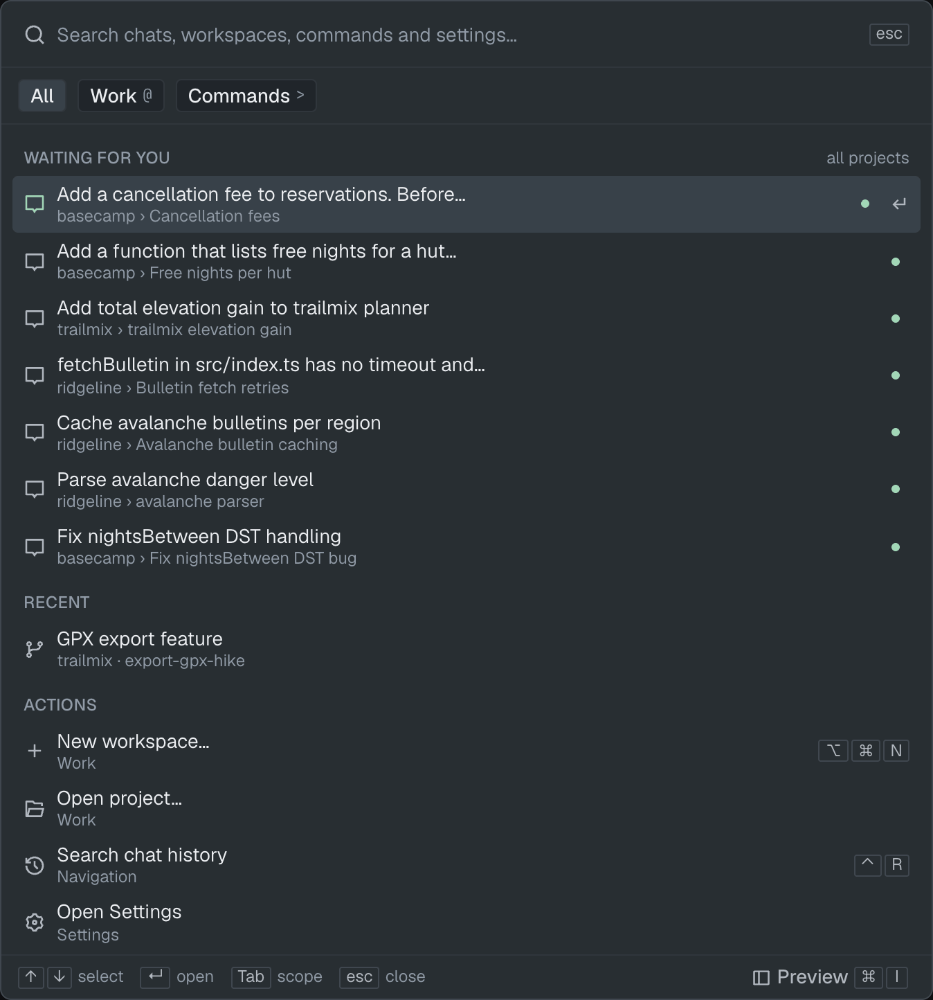
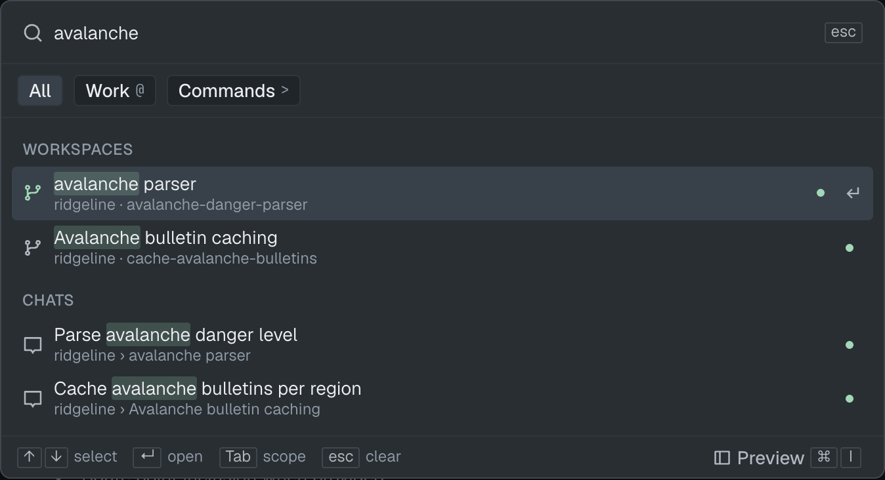
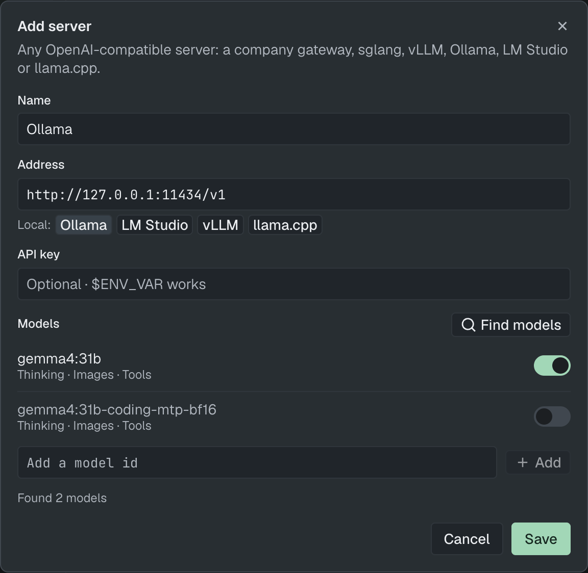
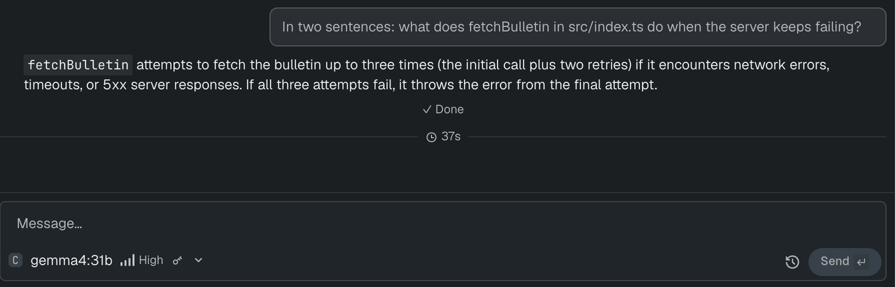
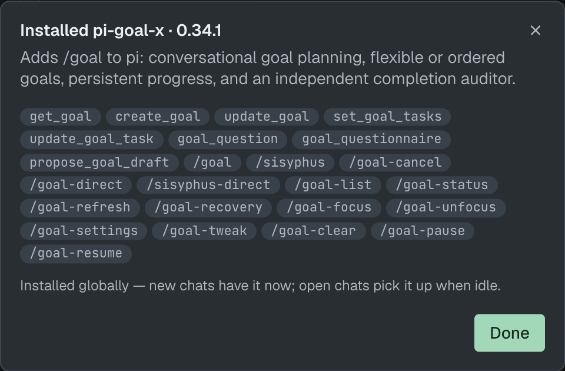
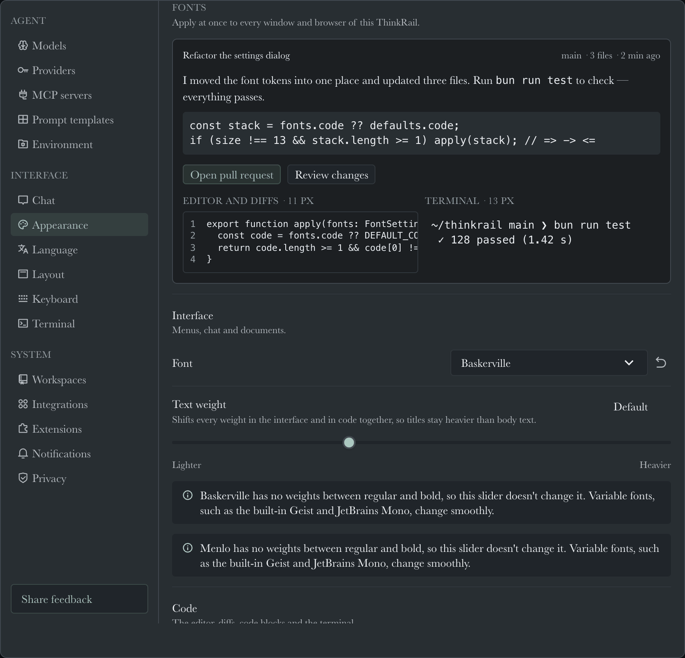
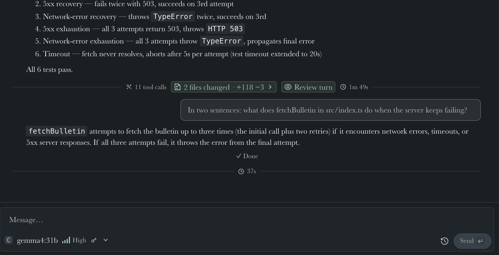
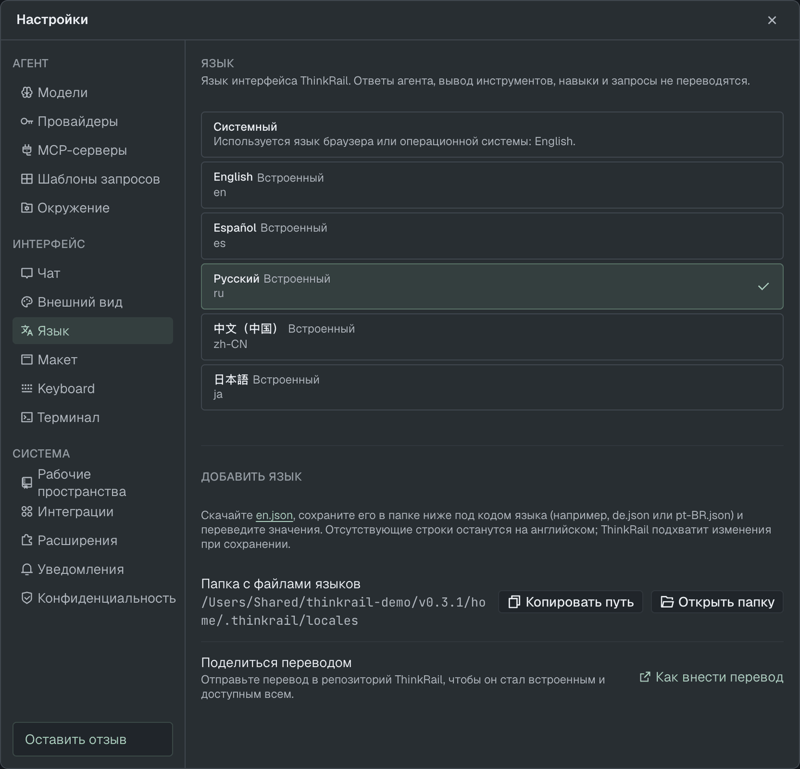

[ThinkRail](https://thinkrail.ai/?utm_source=blog&utm_medium=organic-social&utm_campaign=release-0-3-1) 0.3.1 is out. The new release of ThinkRail introduces a few new features that we've been working on for some time, as well as a number of fixes and other changes. Here's what I find the most important among them.

## One box to find and run things

The chat that's stuck on a question is always in the project you collapsed. Not anymore.

Double-tap **Shift** (or `⌘K` / `Ctrl+K`, or the search button in the topbar). An empty box shows what's **waiting for you** across every open project, most urgent first.

Type a few letters to find any chat, workspace or project, run a command, or jump to a Settings section (`>prov` → Providers). It learns which result you pick.

This is step one. The plan is to make this box the way you do everything in ThinkRail; files and specs are next.

## Your own model server, no JSON

Company gateway or a model on your laptop: **Settings → Providers → Add server**. Pick a preset (Ollama, LM Studio, vLLM, llama.cpp) or paste an address, hit **Find models**, save.

It lands in pi's `models.json`, so the pi CLI gets it too. The key never reaches the browser.

Limits: OpenAI chat-completions API only, no per-model tuning in the UI.

## pi packages, no terminal

**Settings → Extensions → Install package…** Paste a `pi install` line, a pi.dev or npm link, or a name. You see what it adds before you use it.

Don't like it? Switch it off (ThinkRail chats only, the pi CLI still loads it), update it or remove it from the same row.

## Hate our font? Swap it

**Settings → Appearance → Fonts**: interface and code font, weight, size, ligatures. Use installed fonts or drop in your own files. Applies everywhere at once.

Heads-up: code ligatures are now off by default.

## More languages

Russian joins English, Spanish, Simplified Chinese and Japanese. Missing yours? Add it under **Settings → Language** and send it to us.

## Fixes

- macOS: no more "Maximum call stack size exceeded" crash mid-reply.
- Desktop links open once, in your browser. Not twice, not never.
- No false unread dot when a background job finishes right after your turn.
- Resources stops showing finished subagents as **Working**.
- "1.0 MB", not "1024 KB".

Thanks to everyone who sent PRs, and welcome to first-time contributors [@arhipov-om](https://github.com/arhipov-om) (the Russian translation) and [@kevin9327](https://github.com/kevin9327).

## Try it

Grab the desktop app below, or see the rest of what ThinkRail does on [**our main webpage**](https://thinkrail.ai/?utm_source=blog&utm_medium=organic-social&utm_campaign=release-0-3-1). The full list of changes is in the [**v0.3.1 release notes**](https://github.com/JetBrains/thinkrail/releases/tag/v0.3.1).

Find us on social media platforms: [**X/Twitter**](https://x.com/ThinkRailAI), [**YouTube**](https://www.youtube.com/@ThinkRailAI), and [**TikTok**](https://www.tiktok.com/@thinkrail).
You can also browse [**our GitHub repository**](https://github.com/JetBrains/thinkrail),
take [**our survey**](https://forms.gle/es1ksqAax6hnDWCP8), and join [**our Discord server**](https://thinkrail.ai/discord)
to say "hi!" and let us know what you think. Your feedback is greatly appreciated.

Happy developing!

------

*ThinkRail is backed by JetBrains, leveraging their expertise in building developer tools that are both powerful and intuitive.*
