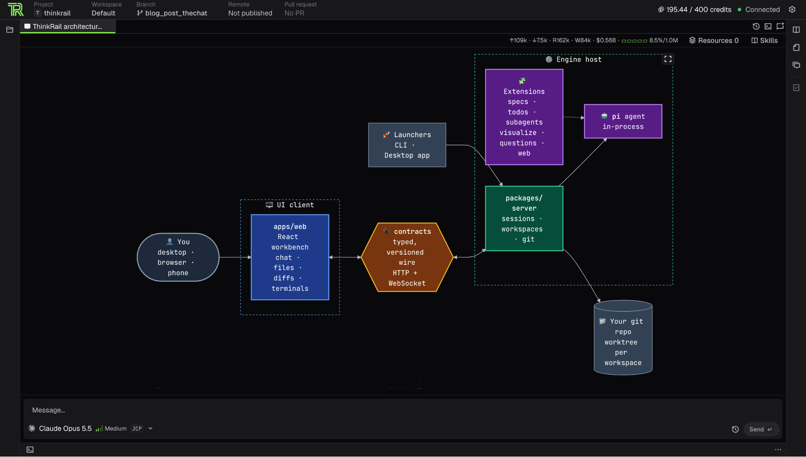

# The Chat

The main part of ThinkRail's GUI is the chat window. Here you can talk to your AI agent. The main language to use is... You might have thought of English, but no, not necessarily. Admittedly, prompting in a language other than English comes with a price [there is a scientific study about it](https://arxiv.org/abs/2609.39001); so, at least until LLMs improve in this area, we will probably stick to English simply to use fewer tokens.

By the way, if you are not a native English speaker, you can go to Settings → Language and at least switch the language of ThinkRail's GUI. For now, we support English, Spanish, Russian, Chinese (Simplified), and Japanese. Let us know if you would like us to feature your own.

There is also another meaning behind the term "the main language". ThinkRail uses Markdown to make your conversation with the AI agent prettier and more readable. Of course, we don't expect you to write in Markdown, but the response you get will use it, and thanks to that ThinkRail will be able to display the response using tables, numbered and bullet-point lists, chapter titles, code snippets, and [Mermaid diagrams](https://mermaid.js.org/) (let your AI agent generate a Mermaid diagram and see for yourself).

But that's not all. When working with your AI agent in ThinkRail, you have probably noticed little light-grey arrows with descriptions such as `> 2 steps bash, thinking`. If you click the arrow, it will unfold into paragraphs of the LLM's thinking process and the agent's tool usage (and the same applies to particularly long messages). In simpler, CLI-based harnesses, this information is often ignored as unimportant and not displayed to the user, so that the screen does not become too crowded with unnecessary text. But since ThinkRail is a GUI, we can have both: readability and access to lots of additional information.

And one more thing about code highlighting: ThinkRail currently ships with 36 supported programming and markup language (you can read the whole list [here](./languages/)). In the same chat window you can open code files and diff files (they are read-only, but they will be highlighted as well). For the former, click on the "Files" button on the right edge of the GUI. The "Files" view will appear, displaying the codebase. Click on any supported file and it will open in the chat window. For highlighting, ThinkRail uses [**Shiki**](https://shiki.style/), a syntax highlighter based on the same engine as VS Code's syntax highlighting.

To see the latter, you will need to let your AI agent make some changes to the codebase. A new tab, "Changed", will appear in the "Files" view, displaying a list of changed files. Click on any of them and the chat window will show you a diff file.

Now, let's say we have an icon, available both as a PNG and as an SVG. If I click on the PNG file, it will be displayed in the chat window. If I click on the SVG file, the same thing happens, but I will also be able to switch between the SVG as a picture and as a text file. And if I ask the AI agent to make changes to the SVG file, and then open it from the "Changed" tab in the "Files" view, ThinkRail will let me compare both versions in their graphical form.

<iframe src="https://youtube.com/embed/8lOC4hmzSds" width="640" height="360" allow="autoplay" allowfullscreen></iframe>

## Try out ThinkRail

Grab the desktop app below, or see the rest of what ThinkRail does on [**our main webpage**](https://thinkrail.ai/?utm_source=blog&utm_medium=organic-social&utm_campaign=gui-overview).

Find us on social media platforms: [**X/Twitter**](https://x.com/ThinkRailAI), [**YouTube**](https://www.youtube.com/@ThinkRailAI), and [**TikTok**](https://www.tiktok.com/@thinkrail). You can also browse [**our GitHub repository**](https://github.com/JetBrains/thinkrail), take [**our survey**](https://forms.gle/es1ksqAax6hnDWCP8), and join [**our Discord server**](https://thinkrail.ai/discord) to say “hi!” and let us know what you think. Your feedback is greatly appreciated.

Happy developing!
------

*ThinkRail is backed by JetBrains, leveraging their expertise in building developer tools that are both powerful and intuitive.*
