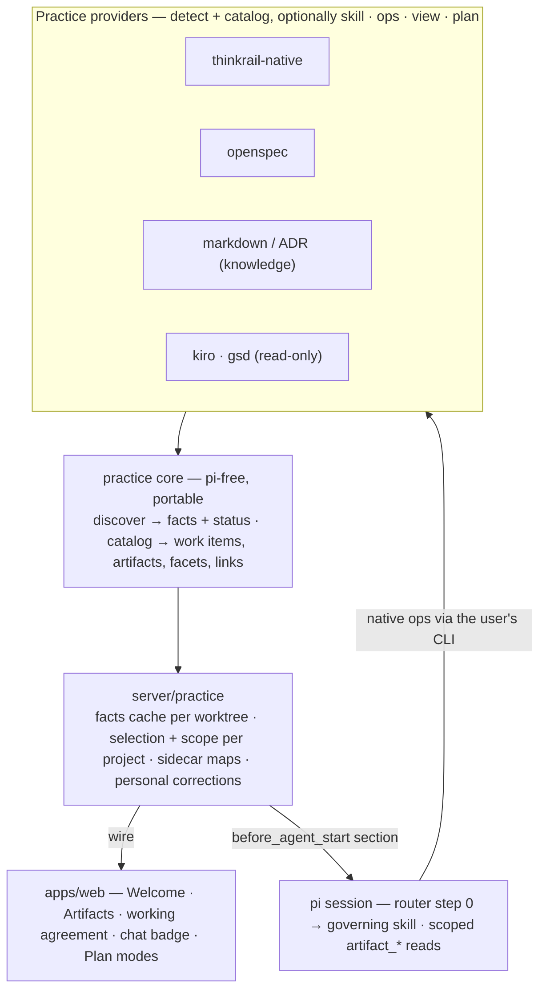

# Spec-driven development in ThinkRail: architecture

**Status: handoff of an architecture discussion (2026-11-02). Not implemented, not approved.**

Entry point for the team. The [proposal](spec-driven-development.md) holds the product scenarios and
the *why*; this document holds the architecture, the decisions taken so far, and what is still open.
Details live in [mapping and adoption](spec-driven-development/mapping-and-adoption.md),
[provider sketches](spec-driven-development/provider-sketches.md), and
[isolation cases](spec-driven-development/isolation-cases.md). Where this and the proposal disagree,
the proposal has not been updated yet — reconcile, do not pick one silently.

## Concept

The move an IDE made from its own build system to Gradle, Maven, Bazel and Make: ThinkRail's spec
graph and workflow family become **one practice system among several** (OpenSpec, Kiro, GSD, homegrown
RFC/ADR processes). A **practice** is how a project works with specs — where documents live, which
instructions apply, what needs approval, how work progresses. ThinkRail *links* the project's practice
instead of imposing its own. The analogy guided the decisions below; it is a guide, not an equality.

| IDE with build systems | ThinkRail with practice systems |
|---|---|
| IDE-native build (JPS) | `pi-spec-graph` + `pi-thinkrail-workflow` |
| `build.gradle` / `pom.xml` are the truth; `.iml` is a generated cache | Practice files are the truth; generated views are read-only |
| Detect `pom.xml` (passive) ≠ link the project (explicit, approved) | Discover (passive, trust-free) ≠ select a practice (explicit, persisted) |
| Linked systems persisted per project; "build files changed — reload" | Selection persisted per project; "practice files changed" at a safe checkpoint |
| Common Workspace Model, populated by every build system | Common artifact catalog, populated by every provider |
| Run/Test windows are neutral surfaces fed by the build system | Plan pane and Artifacts panel are neutral surfaces fed by the governing provider |
| "Build and run using: Gradle / IDEA" | Plan and lifecycle owned by the governing practice, with a way back |
| Sync failure keeps the last good model, never silently falls back | `unreadable` / `stale` keep last-good facts; ThinkRail's default only after a **successful** empty scan |

Where the analogy breaks: build files have no prose (many practices are `CONTRIBUTING.md` sentences the
agent interprets); a `pom.xml` cannot rewrite the IDE, but a practice steers the agent (trust matters
more); and JPS became legacy while ThinkRail's interview discipline is a product feature that stays the
default.

## Goals

- Follow the project's documented practice; never require ThinkRail's format, a migration, or a manifest.
- ThinkRail's own practice is one provider behind the same contract **and** the default when a
  successful scan finds nothing.
- One owner per operation: documents and progress stay in their original systems; no second plan.
- Discover without activating: opening a project reads files; it executes nothing and grants no trust.
- Keep facts (what files report), interpretations (disposable, source-linked) and user corrections
  (durable, scoped) apart.
- Focus: a selected practice scopes what the agent and UI see; other practices are reachable only when
  the user asks.

## Overview

Practice **providers** (ThinkRail-native, OpenSpec, Markdown/ADR, Kiro, GSD) detect evidence and
expose artifacts through a **common, coarse catalog**. The **host** caches detection facts per
worktree, persists the project's **selection and scope**, and serves both to the UI (Artifacts panel,
working agreement, Plan pane) and to the agent as one prompt section. The agent follows the governing
provider's skill, reads artifacts through generic scoped tools, and runs native operations through the
user's own CLI. A provider's web half renders what the common model cannot carry.

## High-level architecture

**Three layers, not one.** *Availability* (which provider code is built and enabled — app-global,
Decision 21 registries) · *Detection* (which practices this worktree shows evidence of — derived,
cached, statuses `none / found / ambiguous / unreadable / stale`) · *Activation and scope* (which
practice governs this project and what the agent and UI see — per project, persisted, user-correctable,
enforced through the existing skill admission gate, pi's active-tool API, the prompt section and the
Artifacts filter). Selecting a practice is a scope, not plugin enablement.

**Provider contract** (names provisional): `detect` and `catalog` are required and file-parse only;
`skill`, `ops` (CLI-backed by default), `view` (renderers for kinds the common model cannot carry) and
`plan` (`none | projected | mirrored`, with the side of truth declared) are optional.

**Common model**, coarse by design: work items and artifacts with facets — purpose, role, lifecycle,
authority — links marked explicit or inferred, and `unknown` legal everywhere. Designed against
OpenSpec, Kiro and ADRs first; `spec-graph` fits last.

**State owners.** Facts: host, derived, per worktree. Selection and scope: host, persisted, per
project. Per-task interpretation: the chat. Personal corrections: host, per owner × project. Project
corrections: the project's own guidance. Task identity for mirrored plans: a gitignored host sidecar.

**Agent feeding** stays "feed, never assemble": one host-emitted prompt section names the governing
practice, sources and status; the root router gains a step 0 that reads it; `brainstorming` runs only
when ThinkRail governs; unselected workflow providers contribute no skills, tools or prompt text;
`shipping-a-pr` stays practice-neutral.

## Decisions

Taken by the product owner in this discussion. On approval they move into the proposal and the owning
specs.

1. **Selection per project**; detection facts per worktree.
2. **ThinkRail's practice applies by default** when a successful scan finds no practice — the interview
   discipline is a feature, not a fallback.
3. **Mixed** (ThinkRail graph plus another system): ask once, persist.
4. **Plan ownership is a provider capability** — `none` / `projected` / `mirrored`. Mirroring is the
   target for full integrations; two independent plans are rejected; projection is acceptable.
5. **Side of truth declared per provider, native file preferred.** ThinkRail-native's truth is the host
   TODO plan, which *is* its native plan.
6. **Id-less native tasks** get identity through a host-owned gitignored sidecar map; ids are never
   written into native files.
7. **The practice core is a new portable pi package** with a pi-free core; `spec-graph` stays untouched
   and becomes a provider.
8. **In-place frontmatter adoption** (`importing-a-codebase`) stays, but only under ThinkRail's practice.
9. **Agent access**: generic scoped read tools over the catalog plus provider skills; writes stay
   provider-specific.
10. **Auto-detect, never auto-apply**: scan on open and on practice-file changes; changes surface at a
    safe checkpoint; selection changes only by user action.
11. **Saved guidance by scope**: personal → host-managed per owner × project; project → the project's
    existing guidance. No third store.
12. **Now vs later**: shape the concepts, contract, model, state, surfaces and decision text now,
    including how ThinkRail-native and OpenSpec fit; refactor ThinkRail-native into a provider
    extension, build OpenSpec, the mirroring backend, GSD investigation, durable runs and third-party
    providers later. The first slice is chosen only with a detailed delivery plan.

## Open questions

The last review round was composed but not answered; settle these with the product owner before writing
contracts. Leading options are in the detail docs.

1. **Scope model** — per-provider state `governs / reference / hidden` with defaults, or binary?
2. **Provider kinds** — `workflow` vs `knowledge` providers, one kind with a flag, or workflow only?
3. **Path scopes** — shape the selection as a list of `{provider, pathScope, scope}` now (write one
   root entry), single selection, or full path scoping in the first release?
4. **Common-model additions** from the OpenSpec sketch — work item node, abstract locator, lifecycle
   provenance, fixed link vocabulary: which go in?
5. **Native-ops trust** — leading option: project trust for user-installed CLIs, MCP-style per-entry
   approval for repo-defined commands.
6. **UI delivery** — leading option: grow Decision 21's `define*` objects (server `practiceProviders`;
   web artifact renderers by kind, optional panel, plan source). Confirm no new plugin system is needed;
   runtime-loaded third-party providers stay deferred.
7. **Mirroring backend** — the `todos` plan-backend seam and sidecar map, before the first mirrored
   provider.
8. **Delivery plan and first slice** — candidate cut: recognize and show → delegate the workflow →
   first native-ops integration (OpenSpec).

## Risks

The common model (too rich = the rejected universal hierarchy; too thin = a file tree with badges) ·
prose practices read differently per chat · routing is prompt-enforced and the routing suite burns
real tokens · plan coupling (per-step commits, plan review, PR body) · frameworks without an API drift
by version · no in-app review surface for drafted documents · discovery cost across providers · saved
guidance precedence.
