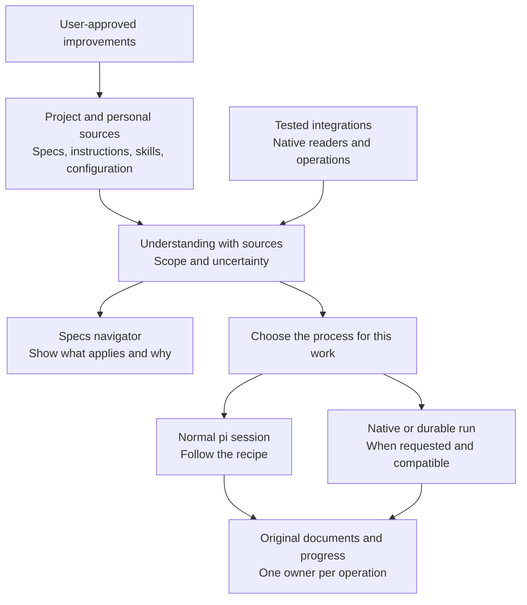
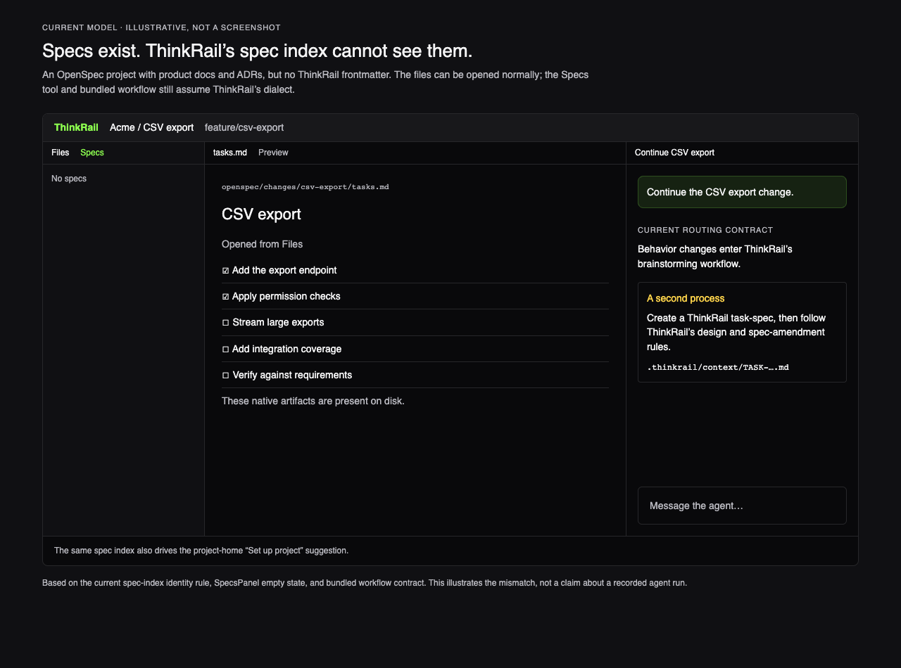

# Proposal: project-native spec-driven development

**Status: Draft for team review. Not implemented.**

Review the direction, ownership boundaries, and first delivery scope. API names, storage formats,
and final UI come later. The current [product goals](../../goal-and-requirements.md) and
[architecture](../../architecture.md) remain authoritative.

**Quick review:** [proposal](#1-proposal) → [scenarios](#3-user-scenarios) →
[design](#4-design) → [open questions](#9-team-review-questions).

## 1. Proposal

**Use the project's existing specs and instructions instead of requiring ThinkRail's format.**
Support homegrown processes through their documents, then add tested integrations for named frameworks.
No migration, plugin, or new manifest should be required to get started.

A **practice** is how a project works with specs: where documents live, which instructions apply,
what needs approval, and how work progresses. It can come from a framework, team conventions, or both.

The proposed decisions:

- Follow the project's practice rather than adding a mandatory ThinkRail workflow alongside it.
- Default to ThinkRail's practice when no documented process is found—not when discovery fails.
- Keep documents and progress in their original systems, with one owner for each operation.
- Let users save rules and workflows for themselves or their team.
- Build toward full spec/workflow support for selected framework versions, not complete IDE parity.

## 2. Why change?

Today, the spec index requires Markdown with `id` and `type` frontmatter and excludes some framework
folders, including `.gsd`. It drives both the Specs navigator and the onboarding decision that a project
has specs. A well-documented project can therefore look unconfigured.

Bundled workflows also prescribe ThinkRail's temporary per-change design document—the **task-spec**—and
its durable-spec lifecycle. Adding file readers alone would still leave the agent following the wrong
process. Recognition, navigation, and workflow routing need to change together.

Keep the existing model for projects that want it; stop making it a prerequisite for everyone else.
Current contracts: [spec-graph](../../packages/spec-graph/SPEC.md),
[workflow skills](../../packages/pi-thinkrail-workflow/skills/SPEC.md), and
[spec viewer reads](../../packages/server/src/spec/SPEC.md).

## 3. User scenarios

### A team's RFC and ADR process

**“Add organization-level permissions.”** The team requires a request for comments (RFC) for significant
changes and uses architectural decision records (ADRs). ThinkRail reads the relevant constraints,
drafts an RFC using the team's template, and asks who approves it if the guide is silent. It does not create
a parallel ThinkRail task-spec.

### An OpenSpec change

**“Continue the CSV export change.”** ThinkRail finds the existing change, its selected schema, and the
team's instructions. It continues the existing plan and uses native validation and lifecycle operations
where supported. The change's schema matters: it may differ from the project's current default.

### A feature started in Kiro

**“Continue this feature.”** ThinkRail reads the existing requirements, design, tasks, and applicable
steering guidance. It establishes where work stopped and preserves the artifacts for use in either
tool. A design file's existence is not proof of approval; missing approval evidence prompts a question.

### Mixed practices

OpenSpec governs changes, ADRs record decisions, and Markdown describes the product. All can inform one
task. An old Kiro directory does not activate another process. If parts of a request genuinely use
different processes, split the work into scoped units or ask—do not invent a combined workflow.

### A framework that owns execution

**“Continue the current GSD slice.”** Implementing a task from its plan is not necessarily resuming
GSD's workflow. The researched GSD Pi snapshot stores workflow state in a database; some Markdown is a
generated view. Editing a checkbox does not complete native work.

Prefer compatible native continuation. If unavailable, explain the setup or compatibility gap and
offer document-led work as a distinct choice. GSD Pi embedding into ThinkRail has not been verified.

## 4. Design

### Where the workflow comes from

A spec describes what to build or what is true. A workflow supplies the steps, approval gates, and
completion rules. ThinkRail follows those instructions; it does not infer a workflow from filenames
or generate a new one just because it found specs.

The instructions come from:

- **The project's process:** team guides, installed framework skills, and their applicable configuration.
  For OpenSpec, the change's selected schema defines artifacts and dependencies; workflow instructions
  and native tools govern how the change is carried out.
- **A user-selected procedure:** an existing or explicitly saved skill/recipe, subject to the project's
  rules. A useful procedure does not need a framework integration to be followed.
- **ThinkRail's bundled skills:** the default when successful discovery finds no documented process.
  Product documentation alone is context, not evidence of a different process.

The pi agent normally follows these instructions in the current session. An integration supplies
native operations where needed. Durable execution, such as resuming a framework-managed run,
additionally requires a compatible runner. A document's status, such as `draft` or `accepted`, is not
itself a workflow or proof that its steps ran.

### Separate documents, instructions, and actions

- **Artifacts:** documents or native records, their identity, type, status, and relationships.
  One work item may span several files or live in a database.
- **Guidance:** scoped instructions, templates, skills, and approval rules.
- **Operations:** editing documents or invoking native capabilities such as validation, archiving,
  and run continuation.

The host discovers sources and available capabilities. The pi agent interprets applicable guidance;
integrations handle framework-specific formats and operations. The UI shows their results.

### Preserve native structure

Keep useful distinctions without requiring one type hierarchy:

- **Purpose:** product, requirements, architecture, decision.
- **Role:** maintained reference, working proposal, process guidance.
- **Lifecycle:** draft, accepted, superseded, archived, or a native state.
- **Authority:** editable source or generated view.

A proposed design is not a description of the current system. A completed change may remain as history.
Preserve native labels and identities; do not insert frontmatter or delete artifacts to fit ThinkRail's
model. Derive the graph from existing relationships, distinguish explicit links from inferred ones,
and leave unknown information unknown. Browsing files must work without complete classification.

### Discover without activating

Opening a project may inspect files and configuration. It must not execute repository code, install
tools, start a framework, or launch an unrequested model analysis. The agent interprets guidance during
requested work or explicit orientation; until then, the UI can show candidate documents.

Distinguish **none found**, **ambiguous**, **unreadable**, **stale**, and **native operation unavailable**.
Only a successful inspection finding no documented practice selects ThinkRail's default. Discovery
never grants trust or bypasses existing permissions and file-access boundaries.

### Remember sources, not guesses as policy

Use the active worktree's sources. Cache their references, revisions, scope, and uncertainty; refresh
affected findings when sources change. Surface changed guidance at a safe checkpoint; do not silently
switch the process during ongoing work.

Keep three kinds of information separate:

1. **Facts:** what documents, configuration, or native state report.
2. **Interpretations:** disposable inferences linked to their sources.
3. **User corrections:** durable, scoped preferences that survive cache deletion.

Project customization overrides generic framework conventions. Conflicting project/personal rules or
equally plausible processes require clarification. Old private memory must not silently override
changed team policy.

### Give each operation one owner

Select one governing process per piece of work. Enable ThinkRail's task-spec lifecycle only when its
practice governs. Review, verification, questions, and visualization remain reusable tools.

If native tasks own the plan, show or link them rather than create another independently editable
ThinkRail TODO list. A checked task is not automatically verified. Integrations must also assign
ownership of commits, scheduling, and worktrees. Before native writes, recheck current state and respect
the framework's concurrency controls.

### Show what applies and why

The Specs navigator shows native groups and types alongside team documents. A **working agreement**
view explains the selected process, its sources, and unresolved questions; it is not another required
file. A task can say “Using OpenSpec for this change” and let the user correct that choice.

These mockups illustrate the experience, not shipped behavior or final UI.

Compare with the current model

An illustration of current contracts, not a captured agent run:

## 5. Save and adapt workflows

Offer **personal** reuse across projects and **shared project** scope. Make the save destination and
activation conditions explicit. Shared edits, workflow saves, and installations require user approval;
inferred habits do not become policy automatically.

### Add a rule

**“Authentication RFCs need security approval.”** Remember the correction for this user's project,
record its origin, and offer to add it to existing team guidance. Once shared guidance covers it,
retire the duplicate private rule. Cross-project reuse requires choosing personal scope.

### Customize a workflow

**“Add a threat-model step before implementing our OpenSpec changes.”** Propose an edit to the
framework's native schema, templates, configuration, or instructions. For a skill-based process, use
its supported skill-customization mechanism; for a homegrown process, edit its guide. Explain
unsupported variations rather than maintain a hidden ThinkRail fork.

Skills can be authored or revised during a conversation as reviewable changes to reusable instructions.
That does not mean autonomous self-modification or hot-swapping a running workflow. When an approved
revision takes effect—on the next use or through an explicit switch during the current task—remains an
open decision.

### Save a procedure

**“Save our incident-fix process.”** Turn the useful steps into a skill or recipe, not a transcript.
Define its trigger, inputs, approval gates, outputs, and verification. Reference existing guidance
rather than duplicate it; reuse current skill discovery and trust mechanisms.

Normally, the pi agent follows the recipe in a regular session. A framework, plugin, user, or applicable
instructions may request a **durable run** with persisted stages, pause/resume, and cancellation.
Instructions cannot supply a missing runner or authorize its execution. Use a compatible runner when
available; otherwise explain the gap and ask before switching modes.

## 6. Framework support

An unfamiliar framework remains usable through its documents. A maintained integration adds tested
knowledge and native operations. **Full support** means its spec/workflow lifecycle works for declared
versions and customization boundaries—not that ThinkRail reproduces the framework's entire product.

An integration must discover the applicable context and support the selected practice's operations,
not impose a fixed sequence. These may include creating a change, implementing tasks, validating
artifacts, archiving work, and customization. It must preserve approvals, read authoritative progress,
handle external changes, and explain setup requirements. When it runs work, it also owns or explicitly
delegates cancellation/resume, commits, scheduling, and workspaces.

Missing prerequisites and unsupported operations are different failures. Do not claim full support
while silently replacing a promised native operation with document-led assistance.

ThinkRail keeps its existing in-process pi engine. Sharing pi ancestry does not prove compatibility;
GSD needs an embedding and lifecycle investigation. A second agent runtime requires a separate
architecture decision. Generic document support does not depend on that investigation.

The foundation does **not** require a universal workflow language, new orchestrator, plugin marketplace,
mandatory practice manifest, or universal task synchronization.

## 7. Alternatives

- **Agent-only interpretation:** low adoption cost, but repeats discovery and can produce different
  answers across chats. Keep its flexibility; add cached evidence and explicit uncertainty.
- **Descriptor-first configuration:** reproducible locations and scope rules, but another format to
  maintain beside native configuration. Allow explicit mappings when needed; do not require them.
- **Integration-first platform:** high native fidelity, but makes unfamiliar and homegrown practices
  second-class. Use integrations for deeper support, not as the prerequisite for useful work.

The trade-off: broad document-led help first, native fidelity where tested. Prose alone cannot reveal
all runtime state.

## 8. Rollout and validation

Recommended sequence; the team still needs to choose the first delivery scope:

1. **Foundation:** custom RFC/ADR processes and ThinkRail's default work side by side, with native
   navigation, process selection, and visible sources.
2. **Authoring:** scoped corrections, personal/project workflow saving, and native customization.
3. **First full integration:** OpenSpec, whose custom schemas and change lifecycle test more than
   filename recognition. Investigate GSD Pi compatibility separately and early.
4. **Expansion:** prioritize further frameworks from user demand; add task projections or durable
   execution only when an integration requires them.

Validate with:

- **Disposable repository fixtures:** absent, unknown, mixed, and customized practices; branch changes,
  stale guidance, scope isolation, and zero writes during discovery.
- **Agent scenarios:** follow the selected process, ask only about gaps, preserve approval gates,
  avoid duplicate plans, and save corrections without leaking their scope.
- **Native conformance tests:** exercise actual supported versions through their lifecycle, including
  external state changes, cancellation/resume, and missing prerequisites. Parsing files cannot prove
  execution compatibility.

## 9. Team review questions

The main risks are stale interpretations, hidden private policy, inferred progress mistaken for native
state, and framework version drift. The design addresses them through source tracking, explicit scope,
operation ownership, and versioned integration tests.

1. **First release:** is custom-practice support enough, or must it include a full named integration?
2. **Priorities:** should OpenSpec lead? Which versions and GSD operations should we validate first?
3. **Saved guidance:** where do corrections and workflows live, and how can users inspect, edit,
   remove, and share them separately from cached inferences? When do approved skill edits take effect
   for work already underway?
4. **Conflicts:** how do we present competing rules or changed guidance without repetitive questions
   or silent process switches?
5. **Ownership:** what must change in Plan, commits, and workspaces before a native runner controls them?
6. **Interface:** what is the smallest artifact/capability contract that preserves native structure,
   and are Specs and the working-agreement view the right surfaces?

For objections, name the affected scenario and preferred behavior. Approval of this direction is not
approval of an implementation or a framework compatibility claim.

## References

Framework behavior varies by version; these sources informed the proposal, not a compatibility audit.

- **OpenSpec:** [custom schemas](https://openspec.dev/docs/customize-schemas) and
  [default schema](https://openspec.dev/docs/schemas/spec-driven).
- **Kiro:** [specs](https://kiro.dev/docs/specs/) and [steering](https://kiro.dev/docs/steering/).
- **BMAD:** [overview](https://docs.bmad-method.org/) and
  [project context](https://docs.bmad-method.org/existing-codebases/theory-of-project-context/).
- **GSD Pi:** [current repository](https://github.com/open-gsd/gsd-pi) and
  [auto-mode contract at the researched commit](https://github.com/open-gsd/gsd-pi/blob/9eb537517d648af26a8f2c3e6b473c90d8cd4250/docs/user-docs/auto-mode.md).
  The database/projection distinction refers to this snapshot, not all historical GSD2 releases.
