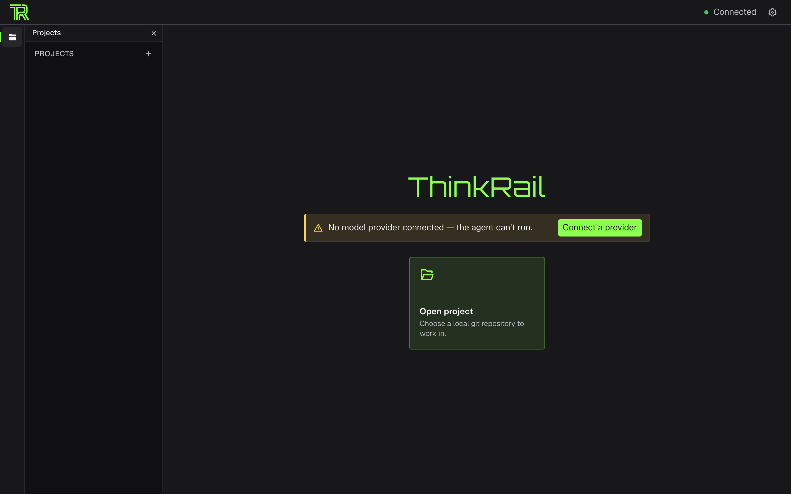
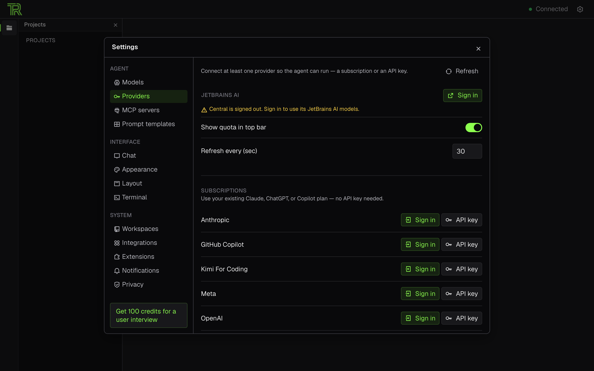
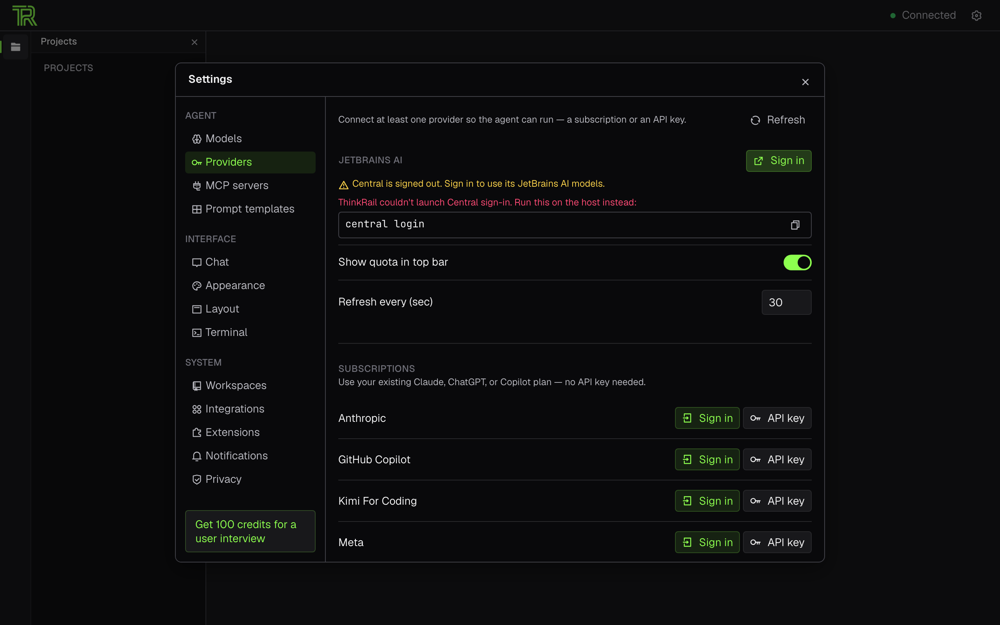
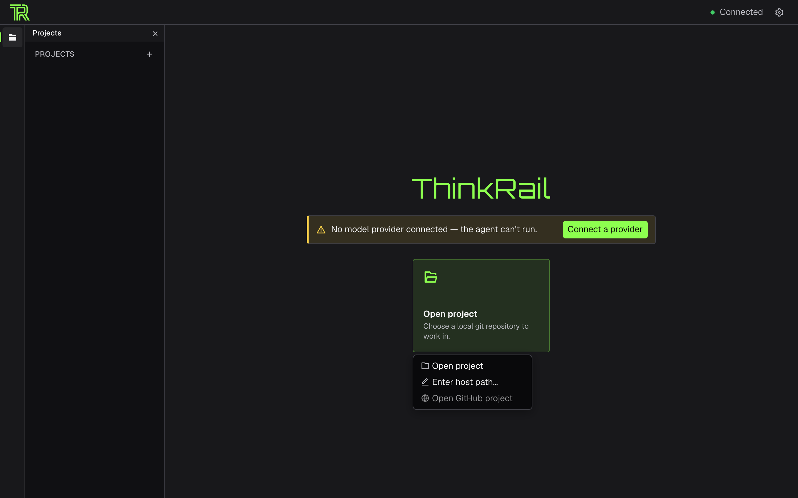
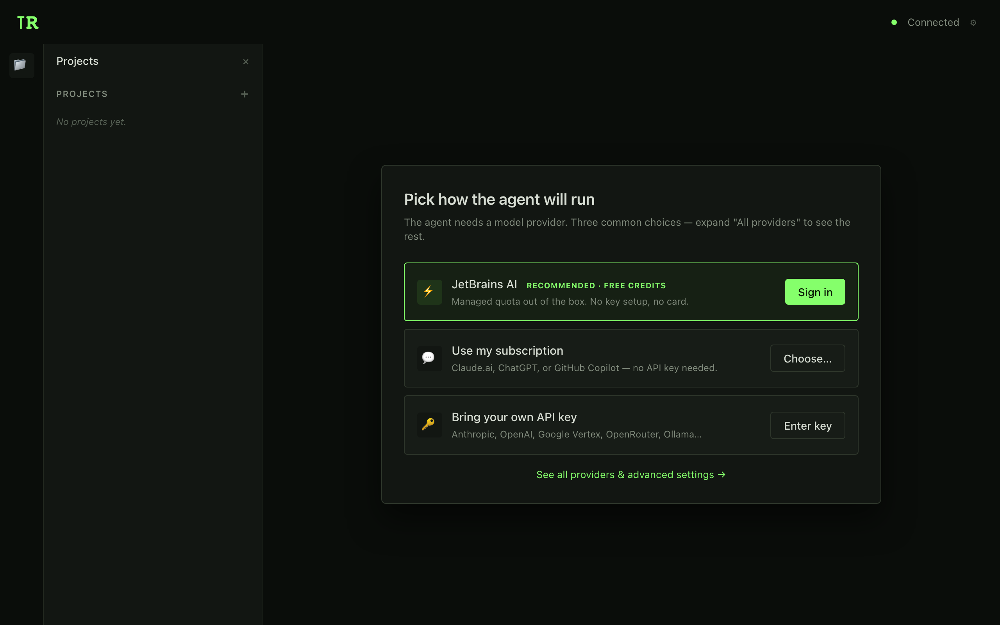
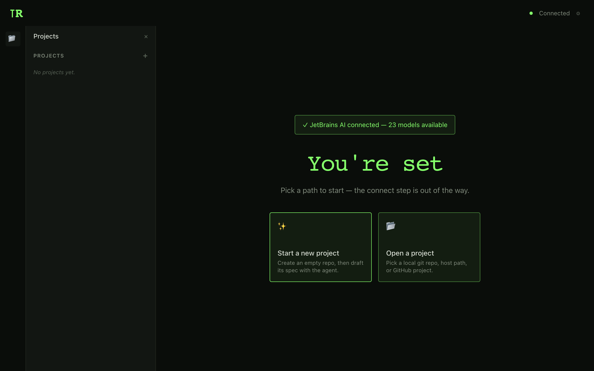
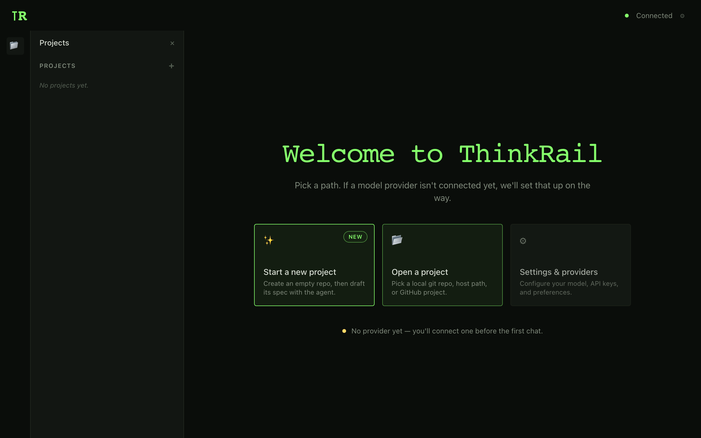
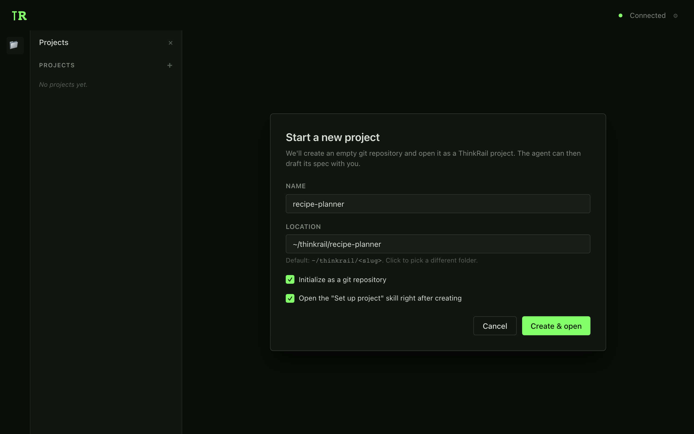

# First-run onboarding — audit & plan

> Status: **draft** · Audience: product + eng · Scope: `apps/web` first-run (`WelcomePanel`, `ProvidersSettings`, `AddProjectMenu`, `LoginDialog`)

Companion doc: [`spec-first-skills-spec.md`](./spec-first-skills-spec.md) covers the skill-side flow once the user is past onboarding. The two are independent — ship separately.

The question this doc answers: **what does a person who just installed ThinkRail and launched it for the first time actually see, and where do they fall off?**

All current-state screenshots are live PNGs from a fresh instance (isolated `HOME` + `THINKRAIL_DATA_DIR` on a non-default port — ships no projects, no provider). All proposed mockups are HTML rendered by the same headless Chrome at the same `1280×800 @2x`. Sources: `.github/readme-assets/onboarding/mockups-src/`, regen with `bun scripts/render-mockups.ts`.

```bash
# capturing fresh first-run shots
rm -rf /tmp/tr-fresh && mkdir -p /tmp/tr-fresh/home /tmp/tr-fresh/data
HOME=/tmp/tr-fresh/home \
  THINKRAIL_DATA_DIR=/tmp/tr-fresh/data \
  THINKRAIL_PORT=28242 \
  bun run dev
# in another shell:
bun scripts/capture-fresh-shots.ts
```

---

## 1. What a new user sees today

### 1.1. First launch



Empty `PROJECTS` sidebar. Hero = `ThinkRail`. Yellow banner `No model provider connected — the agent can't run`. **One** card — `Open project`. The `Set up project` / `Start building` cards never appear until a project is open.

### 1.2. Click "Connect a provider"



Full-screen Settings dialog with **15 sidebar items** and ~15 interactive controls on the right: a `JetBrains AI` section, two global settings (`Show quota`, `Refresh every`), a `SUBSCRIPTIONS` section with 5–6 providers each exposing `Sign in` + `API key` separately. No primary CTA, no recommendation, and the global settings sit **between** auth sections.

### 1.3. Click "Sign in"



In headless / desktop environments where `window.open` returns `null`, the user gets a red panel with a CLI command `central login` as the only way forward. In a normal browser this would open an OAuth tab — but there is no fallback UI if the popup is blocked.

### 1.4. Close Settings


Store state is actually correct after a successful connect — the server pushes `WS_CHANNELS.providerChanged`, `wireTransport.ts:266` reacts with `noteProviderChanged()` (bumps `providerVersion`), and `ProvidersSettings` refetches on both `activeLogin.status === "success"` and `providerVersion`. What's missing is **surfacing** that state change to the user:

- The `ProviderWarningBanner` is **not** subscribed to `providerVersion` — it only re-reads `provider.status` when `settingsOpen` flips back to `false` (`ProviderWarningBanner.tsx:21-23`). So the banner does eventually hide, but only after the user closes Settings by hand.
- There is no toast, no inline success, no hero change — nothing on the Welcome screen that *looks like* "✓ connected" after the modal stack closes.
- Net: the state refresh is silent. The user is left asking "what did I just do?" even though the system knows exactly what they did.

### 1.5. Click "Open project"



Dropdown: `Open project` / `Enter host path…` / `Open GitHub project`. **No "Start a new project".**

---

## 2. Pain summary

| # | Pain | Code |
|---|---|---|
| **A1** | **No support for projects without a repo.** A user who installed ThinkRail to start a new project with AI must first `mkdir && git init` in a terminal. | `apps/web/src/panels/WelcomePanel.tsx:102-104` + `AddProjectMenu` |
| **A2** | **Mess in Settings.** 15 sections × ~15 controls for one task "connect a model". No primary CTA; global settings wedge between the auth sections. | `apps/web/src/panels/ProvidersSettings.tsx` |
| **A3** | **State refresh is correct but silent.** `providerChanged` push + `providerVersion` bump land; `ProvidersSettings` refetches; the warning banner eventually hides — but there's no toast, no inline success, no hero change, and Settings stays open until the user closes it. The user has no cue "it worked". | `apps/web/src/auth/LoginDialog.tsx:198-210` + `ProvidersSettings.tsx:70-72` + `ProviderWarningBanner.tsx:21-23` |
| **A4** | **No fallback for `window.open` fail.** A CLI command as the only recourse is a UX capitulation. | `apps/web/src/auth/LoginDialog.tsx:38` |
| **A5** | **Hero = `PRODUCT_NAME` on fresh**. A missed slot for a welcome line and a "start here" hint. | `apps/web/src/panels/WelcomePanel.tsx:94-96` |

---

## 3. Proposal — if the user has a repo

Today this path mostly works: click `Open project`, pick a folder, land in a project `WelcomePanel` with `Set up project` / `Start building` / `Work in project folder` cards. Two fixes close the remaining pain.

### 3.1. Simplify provider connect (closes A2 + A5)

Replace the full-screen Settings takeover with a focused `ConnectProviderDialog` overlay offering a curated top 3:



- Three cards only: `JetBrains AI` (Recommended, managed credits), `Use my subscription` (expands into Claude.ai / ChatGPT / Copilot), `Bring your own API key` (expands into the full provider list).
- No `Show quota` / `Refresh every` — those stay in full Settings only. A link `See all providers & advanced settings →` opens the full `ProvidersSettings` for power users.
- One primary CTA on the recommended row; the rest are ghost buttons.
- The full `ProvidersSettings` **is not removed** — it stays reachable via that link and the gear icon. This is an onboarding overlay, not a replacement.

### 3.2. Post-connect handoff (closes A3)

The state refresh is already there — what's missing is a **visible** handoff. On `login-success`, close the `ConnectProviderDialog` **and** the parent Settings in one gesture, then surface the state change with an inline confirmation + explicit next step:



- Toast at the top: `✓ JetBrains AI connected — 23 models available` (3–4 seconds) — that single beat is both verification and confirmation.
- Hero shifts to `You're set` + a subhead about picking a path.
- Primary CTA becomes `Start a new project` or `Open a project` — never bounce the user back to the exact same screen they came from.

### 3.3. Popup-fail fallback (closes A4)

`LoginDialog` detects `window.open(...) == null` → shows a UI panel with `Open in browser` / `Copy URL` / "Already signed in on the host? Run `central login`" — the CLI line stays, but as **one of three** options, not the only one.

---

## 4. Proposal — if the user does NOT have a repo

This is the biggest gap. Today there is **no path** — the user must go to the terminal. The fix: add `Start a new project` as the first CTA on the fresh screen and as an entry in `AddProjectMenu`.



What changes:
- Hero: `Welcome to ThinkRail` + a one-line subhead about picking a path.
- **Three cards** instead of one: `Start a new project` (NEW, primary), `Open a project`, `Settings & providers` (ghost — for people who came to configure only).
- Yellow dot at the bottom notes "no provider yet" without blocking anything — the provider connect happens as a step **inside** the chosen path, not as a separate screen takeover.

Clicking `Start a new project` opens a small dialog:



- `Name` (slug), `Location` (default `~/thinkrail/<slug>`, overridable).
- Checkbox `Initialize as a git repository` (default on — ThinkRail's git-worktree invariants rely on it, see `AGENTS.md`).
- Checkbox `Open the "Set up project" skill right after creating` (default on — natural bridge into the skill flow covered in [spec-first-skills-spec.md](./spec-first-skills-spec.md)).
- `Create & open` → `mkdir -p` + `git init` + register as project + open as project + if the second checkbox is on, dispatch `/skill:setting-up-a-project` in a fresh session.

If no provider is connected yet, after `Create` the user flows through the `ConnectProviderDialog` from §3.1, and the skill fires only once the provider lands. The "wizard" behaviour emerges **in the context of the chosen path**, not as a separate full-screen takeover.

---

## 5. Mapping — pain → fix → mockup

| Pain | Fix | Mockup |
|---|---|---|
| **A1** no path without a repo | `Start a new project` card + `CreateProjectDialog` | `proposed-welcome-with-start-new.png` + `proposed-create-empty-project.png` |
| **A2** mess in Settings | `ConnectProviderDialog` overlay with top 3 | `proposed-connect-provider-simplified.png` |
| **A3** silent state refresh | Close modal stack on success + toast + hero shifts | `proposed-post-connect-handoff.png` |
| **A4** popup fail → CLI only | Fallback UI in `LoginDialog` | — (small existing-dialog edit) |
| **A5** hero on fresh | `Welcome to ThinkRail` + subhead | folded into `proposed-welcome-with-start-new.png` |

---

## 6. Plan (ordered by impact)

1. **A1-fix** — `Start a new project` card + `CreateProjectDialog`. **Primary.** Unlocks the whole "I came to start a new project with AI" audience. One self-contained PR.
2. **A2-fix** — `ConnectProviderDialog` overlay with top 3.
3. **A3-fix** — modal-stack close + success toast + hero handoff.
4. **A4-fix** — `window.open` fail fallback in `LoginDialog`.
5. **A5-fix** — welcome hero for fresh (a one-line change in `WelcomePanel`).

The two tracks are independent of the Direction B / skills work — ship either side in isolation. Only A1 overlaps meaningfully with the skill track (the "open the skill right after creating" checkbox is the handoff point).

---

## 7. Open questions

- **OQ1.** `Start a new project` location — always `~/thinkrail/<slug>`, or ask each time? Proposal: default to `~/thinkrail/<slug>` with a picker to override.
- **OQ2.** The `Open the "Set up project" skill right after creating` checkbox — default on, or ask? Proposal: on — natural bridge into Direction B.
- **OQ3.** `ConnectProviderDialog` top 3 — JetBrains AI / Subscription / API key. If a user is on Enterprise without JetBrains AI access, what shows first? Proposal: driven by `provider.status.listAvailable()`.
- **OQ4.** `window.open` fallback (A4) — gate it only in the desktop build or in web too? A browser popup blocker is a real web case.
- **OQ5.** The `Settings & providers` ghost card on fresh (§4 mockup) — is it worth showing when the user hasn't chosen a path yet, or is it redundant with the gear icon?
