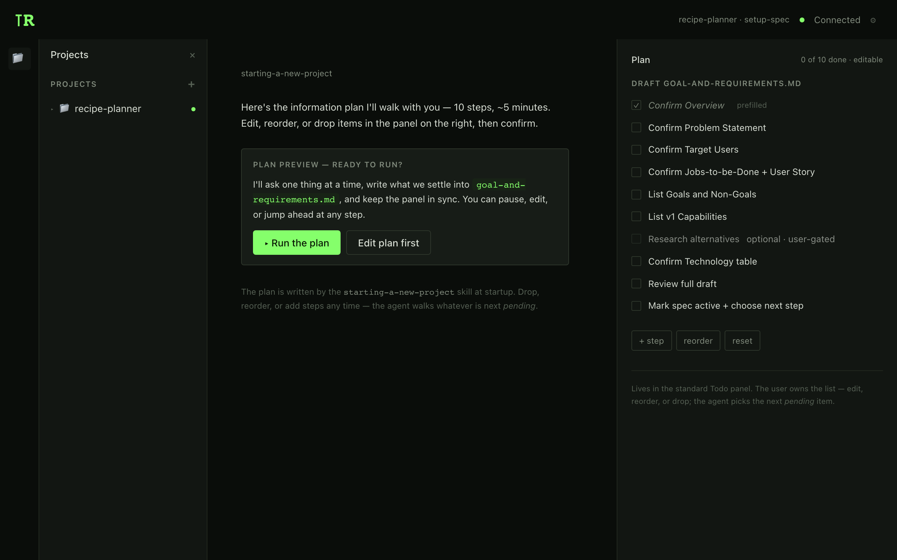
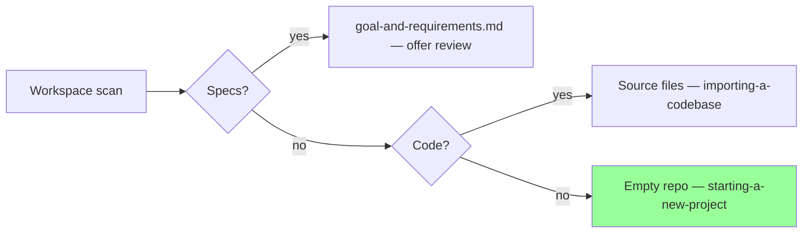

# Spec-first skills — audit & plan

> Status: **draft** · Audience: product + eng · Scope: `packages/pi-thinkrail-workflow/skills/*` + `pi-todos` as a flow medium

Companion doc: [`onboarding-first-run-spec.md`](./onboarding-first-run-spec.md) covers the UI shell that lands a user into these skills. The two are independent — ship separately.

The question this doc answers: **once the user has a connected provider and a project (empty or existing), how does the spec-first flow actually feel, and how do we tighten it using what v1 did right plus `pi-todos` as the flow substrate?**

---

## 1. Context — what v1 had and what v2 inherited

v1 (`/Users/olga.lavrichenko/del/thinkrail-v1/claude-plugin/skills/*`) carried a handful of UX patterns v2 dropped on the way:

| v1 skill | Pattern | What it gave the user |
|---|---|---|
| `new-project` | A **progress tracker** rendered on every step via `thinkrail_visualize type: progress-tracker` | Visible `Step 2/8`, a sense of how much remains |
| `new-project` | **"Looks right / Edit ___"** — every inferred statement confirmed with exactly two options | One click instead of composing a sentence |
| `new-project` | **Fast-path for a pre-filled brief** — if the user pastes a structured brief, parse and save without re-asking | Experienced users don't answer 8 questions for 10 seconds of work |
| `new-project` | **Done-screen via `SessionFinalize`** — queued `create_ticket` / `start_session` actions | A clear next step after the spec is saved (architecture, first capability) |
| `investigate-project` | **Document setup Q&A up front** — 2 questions (depth, sections) before reading any code | The agent doesn't read the whole repo for nothing |
| `thinkrail-brainstorm` | A hard pipeline `product-design.md → design-doc.md → spec-diff.patch`, 3–5 alternatives per step | Discipline, but heavy for simple features |

v2 today:

- **`setting-up-a-project`** — dispatcher routing into 3 branches by repo state. Works. No visual detect step.
- **`starting-a-new-project`** — the "new project" skill. Delegates rules to `writing-specs` + `asking-user-questions`. No visible progress; no explicit "Looks right / Edit" wording; done = "stop" with no next-step card.
- **`importing-a-codebase`** — the v2 counterpart to v1 `investigate-project`.
- **`pi-todos`** — **new in v2, didn't exist in v1.** The canonical way to show a live plan in the UI: groups (tasks) + steps + statuses (`pending → in_progress → done`) + verification/summary. Already rendered in a standard Todo panel that sits next to chat.

---

## 2. The core idea — plan-first flow

Instead of letting the skill improvise its conversation and sprinkling TODO flips as it goes, lift the plan up:

> **At the start of a run, the skill writes the full information-gathering plan into `pi-todos`. The user sees the roadmap, can edit it, approves it, and the agent walks it.**

One group, one ordered list of steps bound to spec sections. The user sees the whole thing up front; the agent flips each item to `in_progress` before asking its question and to `done` once that section is written to disk.



What this buys:

- **Transparency.** "10 steps, ~5 minutes" is a real contract shown before question #1, not vibes.
- **Editability.** The user can drop irrelevant steps, reorder, or add their own — before the walk starts and mid-run. The skill honours whatever the next `pending` item is.
- **Resumability.** If the session dies mid-run, reconnecting shows the same TODOs with the same statuses. The agent resumes from the first `in_progress` or the next `pending`.
- **A single native UI.** No bespoke progress tracker — the live plan sits in the existing Todo panel the user already knows.

The step list is fixed; the per-step wording and inference stay the agent's call.

## 3. Concrete edits to v2 skills

Each edit targets a file under `packages/pi-thinkrail-workflow/skills/`.

### S1 — `starting-a-new-project`: write the plan up front

Add to the "Method" section, replacing today's implicit "ask one section at a time":

```md
### Plan-first run

Right after routing (Personal spec vs PRD, depth known), **write the full plan into pi-todos
before asking anything else**. One group `"Draft goal-and-requirements.md"` whose ordered
steps are the spec sections you intend to elicit, in template order. Omit sections that
`depth` doesn't warrant; put sections `prefilled` from the brief into the plan already
`done`, with `note: "prefilled from brief"`.

Then run exactly one `ask_user_question` round — the Plan preview — with two options:
- **Run the plan** — accept, start walking from the first `pending` item.
- **Edit plan first** — pause. The user drops / reorders / adds steps in the Todo panel.
  Resume on their explicit "Run" after.

While running the plan:
- Before each `pending` step: flip it `in_progress`, then ask its one question.
- After each confirmation: write that section to the spec, flip the step `done` with
  `verification: "user confirmed → saved §<section>"`, advance.
- If a step is dropped by the user mid-run, honour it: never resurrect dropped items.
- If the user adds a step mid-run, it enters as `pending` and will be walked when its turn comes.

The last step of the plan is always `Mark spec active + choose next step` — see S3.
```

### S2 — `starting-a-new-project`: "Looks right / Edit ___" wording

In "Method", replace *"propose a concrete draft and let the user correct it"* with:

```md
2. **Confirm inferred statements via a 2-option round.** Any statement you *inferred*
   (Overview, Problem Statement, Target Users, a Goal, a Capability item) is confirmed
   through `ask_user_question` with exactly two options: "Looks right" (accept) and
   "Edit: _____" (free-text correction). Never ask an open "is this right?" when a
   2-option round is possible — one click beats a sentence.
```

Also promote this pattern into the `asking-user-questions` concept skill as a general norm — not just for `starting-a-new-project`.

### S3 — `starting-a-new-project`: done-screen as the final step

Replace the current closing block `## Next` with:

```md
## Done screen

The final step of the plan is `Mark spec active + choose next step`. On it, flip the
spec `status: active` via `spec_update`, then run one `ask_user_question`:

> `goal-and-requirements.md` is live. What next?

Options:
- **Sketch `architecture.md`** — propose a module split and tech stack from this spec.
- **Build the first capability** — pick one and hand off to `brainstorming`.
- **I'll decide later** — stop here; everything is saved.

Act on the choice: "architecture" starts an inline architecture pass against the
`architecture-design` writing-specs bar; "first capability" lists Capabilities as a
sub-round and hands the chosen one to `brainstorming`; "later" stops.
```

### S4 — `setting-up-a-project` (dispatcher): visual detect

Add one `visualize type: diagram` call in the Detect step (one-off, not per step — step-level
progress lives in the Todo plan published by the downstream skill):



Then route per the table and name the branch to the user. The downstream skill publishes its own Todo plan — the dispatcher itself does **not** publish a plan (it's a one-shot decision, not a multi-step task).

### S5 — `importing-a-codebase`: Document setup Q&A up front

From v1 `investigate-project`: ask 2 questions (depth, sections) **before** reading any code, otherwise the agent reads the whole repo for nothing. Follow the same plan-first pattern — once those two answers land, write the investigation plan into pi-todos (one group `"Draft DESIGN_DOC.md"`) and run through it the same way as S1. Final text pending a full read of the current SKILL.md in a follow-up round.

---

## 4. What we deliberately leave out of v1

| v1 pattern | Why not ported |
|---|---|
| Full `thinkrail-brainstorm` pipeline (`product-design.md → design-doc.md → spec-diff.patch`) | Overkill — v2 uses incremental `brainstorming` + `spec_update`. Approval gates already live in `writing-specs`. |
| `SessionFinalize` with a queued action list | v2 has no "session queue" concept — a single `ask_user_question` done-screen (S3) covers the same handoff. |
| `spec_save` per section | `edit` + `spec_update` do the same thing with a different tool shape. |
| `thinkrail_visualize type: progress-tracker` | Replaced by `pi-todos` — the same effect through the native panel, no bespoke tool. |

---

## 5. Plan

Each item ships one skill file.

1. **S1 + S3** — `starting-a-new-project`: plan-first block + done-screen. One file, two blocks, maximum visible impact.
2. **S2** — "Looks right / Edit" wording in `starting-a-new-project` **and** in `asking-user-questions`.
3. **S4** — `setting-up-a-project` visual detect.
4. **S5** — `importing-a-codebase` document-setup Q&A + plan-first run (needs a dedicated read-through round first).

None of these require code changes outside the skill markdown. The `pi-todos` and `ask_user_question` tools used are already available to every skill.

---

## 6. Open questions

- **OQ1.** Does the Todo panel need to be auto-opened when the skill writes its first plan? If the panel is closed, the user won't see the plan until they open it. Possible fix: a one-line text message in chat the first time the plan is written (`"I just wrote the plan to the Todo panel — open it with ⌘T to review"`) or an auto-open hint.
- **OQ2.** What exactly happens if the user drops **all** steps during the "edit plan first" pause? Treat that as a cancellation ("plan is empty — exiting"), or hard-fail?
- **OQ3.** Should the plan template per branch (Personal spec vs PRD, light / standard / full depth) live inside the SKILL.md as literal lists, or in a sibling file like `starting-a-new-project/plan-templates/*.md`? Second is cleaner for reuse but adds a file. Proposal: inline for now, split later if more branches appear.
- **OQ4.** Mid-run plan edits — how aggressive to be about re-reading? Proposal: re-read via `todo_list` once before each next step is picked (already the `todos` skill norm). No active watcher.
